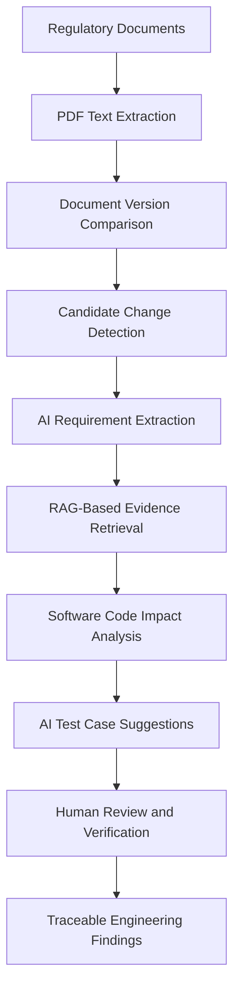
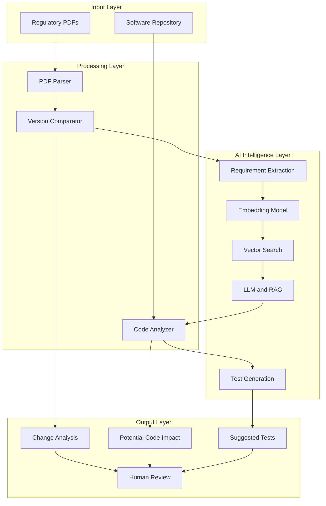
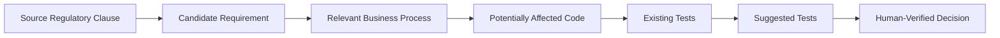

# RegulaLens AI

### AI-Powered Regulatory Intelligence and Software Impact Analysis

**Connecting regulatory changes to software requirements, code components, and test cases through AI.**

## 1. Project Overview

RegulaLens AI is an AI-powered regulatory intelligence platform designed to help fintech teams analyze regulatory changes and understand their potential impact on software systems.

Traditional regulatory analysis often requires teams to manually compare circulars, interpret requirements, search through codebases, and determine which tests may need to change.

RegulaLens AI aims to connect these activities through an evidence-backed workflow that transforms regulatory documents into structured engineering insights.

Its central idea is to go beyond regulatory question answering and establish a traceable relationship between **regulatory clauses, candidate requirements, potentially affected code, and suggested tests**.

## 2. Problem Statement

When a regulatory authority publishes a new circular or revises an existing one, fintech organizations must investigate what has changed and whether their systems are affected.

This process can involve:

* Comparing previous and updated regulatory documents.
* Identifying new or modified requirements.
* Understanding the business processes affected.
* Locating potentially relevant source-code components.
* Evaluating existing tests and identifying gaps.
* Documenting decisions and supporting evidence.

These activities can be time-consuming, fragmented, and difficult to trace across compliance and engineering teams.

RegulaLens AI aims to reduce this investigation effort by connecting regulatory evidence with software engineering workflows.

## 3. Proposed Solution

RegulaLens AI combines document processing, Large Language Models (LLMs), Retrieval-Augmented Generation (RAG), semantic search, and source-code analysis.

The system is designed to:

1. Process regulatory documents and preserve their source references.
2. Compare document versions to identify candidate changes.
3. Extract structured candidate requirements using AI.
4. Retrieve relevant regulatory passages as supporting evidence.
5. Search software repositories for potentially related code components.
6. Generate test suggestions based on requirements and code context.
7. Present findings for human verification.

## 4. System Workflow

The workflow connects document-level analysis with software-level investigation. Each proposed relationship should retain supporting evidence and indicate uncertainty where appropriate.

## 5. Core Features

### 5.1 Regulatory Document Processing

Extracts text from regulatory PDFs while preserving page numbers and document metadata. This provides a searchable foundation for subsequent analysis.

### 5.2 Regulatory Change Detection

Compares earlier and updated document versions to identify candidate additions, deletions, and modifications.

The goal is to distinguish potentially meaningful changes from formatting differences and document reorganization.

### 5.3 AI-Based Requirement Extraction

Uses LLMs to convert relevant regulatory passages into structured candidate requirements, including requirement descriptions, source references, and available applicability information.

Unknown or unsupported details should remain explicitly unresolved.

### 5.4 Evidence-Backed Regulatory Search

Uses Retrieval-Augmented Generation to retrieve relevant passages before generating answers.

Each answer should link back to the source document and relevant passage so that users can independently inspect the evidence.

### 5.5 Software Impact Analysis

Investigates a software repository to identify potentially relevant files, functions, validation rules, database models, and existing tests.

Rather than treating keyword matches as proof, the system aims to provide evidence and reasoning for each proposed connection.

### 5.6 AI-Assisted Test Generation

Generates draft test scenarios based on candidate requirements, relevant code, and existing tests.

Suggested tests may include positive cases, negative cases, boundary conditions, and regression scenarios. Engineering review is required before adoption.

### 5.7 Traceability and Human Review

Connects the source clause, extracted requirement, candidate code component, and suggested test in a reviewable chain.

Human reviewers can inspect, correct, approve, reject, or flag findings that lack sufficient evidence.

## 6. System Architecture

The architecture separates document processing, AI-based interpretation, code analysis, and review. This modular design allows individual components to be evaluated and improved independently.

## 7. Core AI Concepts

### Large Language Models

LLMs help interpret text, extract candidate requirements, classify document changes, and generate test suggestions.

### Retrieval-Augmented Generation

RAG retrieves relevant source passages before an LLM generates an answer. This helps ground responses in available evidence without guaranteeing correctness.

### Embeddings and Semantic Search

Embeddings represent text as numerical vectors. Semantic search uses these representations to find relevant passages even when their wording differs from the user's query.

### Static Code Analysis

Static analysis examines source code without executing it. RegulaLens AI can use repository search and progressively introduce syntax-aware analysis to identify potentially relevant software components.

### Human-in-the-Loop AI

Human review provides a verification layer for generated requirements, code mappings, and test recommendations.

## 8. Traceability Model

The project's defining concept is the relationship between regulatory evidence and engineering action.

Each connection should have a rationale and supporting evidence where available.

If the system cannot establish a sufficiently supported relationship, it should flag the finding as unresolved rather than fabricate a connection.

## 9. Technology Stack

| Component                   | Planned Technology                          |
| --------------------------- | ------------------------------------------- |
| Backend                     | Python and FastAPI                          |
| Document processing         | PyMuPDF                                     |
| AI reasoning and generation | Large Language Models                       |
| Retrieval                   | RAG and embeddings                          |
| Vector search               | Chroma or FAISS                             |
| Source-code analysis        | Python-based repository and syntax analysis |
| Data storage                | SQLite or PostgreSQL                        |
| Frontend                    | React and Vite                              |
| Testing                     | pytest                                      |

These technologies represent the intended architecture and may evolve as the project develops.

## 10. Intended Impact

RegulaLens AI aims to help fintech engineering and compliance teams:

* Investigate regulatory changes more efficiently.
* Connect regulatory evidence with software components.
* Identify potential testing gaps earlier.
* Reduce fragmented manual searching.
* Improve traceability between requirements and implementation.
* Make AI-generated findings easier to verify and audit.

## 11. Limitations and Responsible AI

RegulaLens AI is intended as a decision-support system, not a substitute for legal, compliance, or engineering expertise.

AI-generated interpretations may be incorrect. Code matches may not represent actual regulatory impact, and suggested tests may be incomplete.

The system should preserve source evidence, communicate uncertainty, and require appropriate human verification before decisions are adopted.

---

**RegulaLens AI — From regulatory change to traceable engineering action.**
