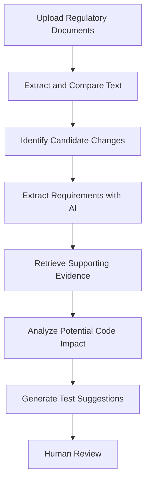
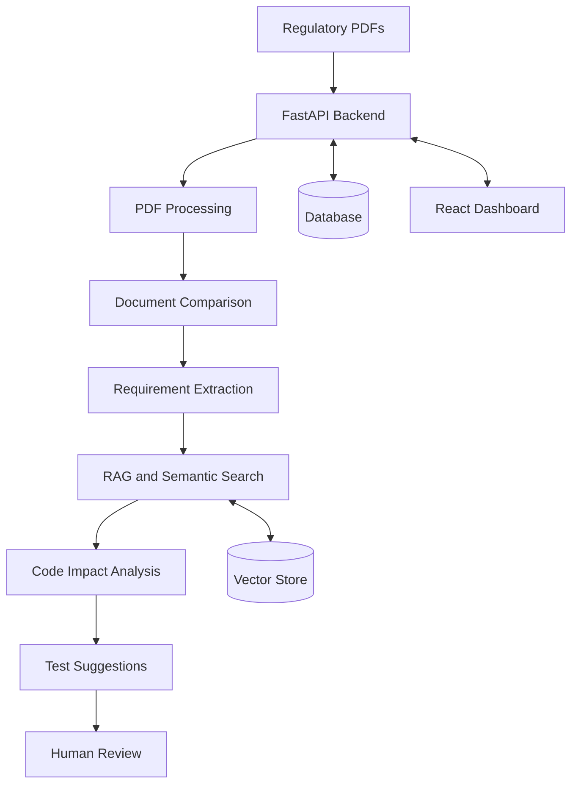

# RegulaLens AI

### AI-Powered Regulatory Intelligence and Software Impact Analysis

**From regulatory changes to traceable software engineering actions.**


## Overview

RegulaLens AI is an AI-powered platform designed to help fintech teams understand regulatory changes and investigate their potential impact on software systems.

Instead of only answering questions about regulatory documents, RegulaLens AI aims to connect regulatory clauses with candidate requirements, potentially affected code components, and suggested test cases.

**The goal:** Make regulatory change analysis more traceable, explainable, and useful for engineering teams.

> Project status: Under development. Features described here represent the planned system unless otherwise stated.

## The Problem

When a regulator updates a circular, fintech teams may need to manually compare documents, interpret requirements, locate relevant code, and update tests.

These activities can be time-consuming and difficult to trace across teams and tools.

## Proposed Solution

RegulaLens AI combines document processing, Retrieval-Augmented Generation (RAG), and source-code analysis to support the regulatory change workflow.

### How It Works



## Key Features

* **Regulatory Document Processing:** Extract text and page references from PDF documents.
* **Change Detection:** Compare document versions and identify candidate changes.
* **AI Requirement Extraction:** Convert relevant passages into structured candidate requirements.
* **Evidence-Backed Search:** Retrieve relevant regulatory passages using RAG.
* **Software Impact Analysis:** Find potentially relevant code files, functions, and existing tests.
* **AI Test Generation:** Suggest test scenarios for engineering review.
* **Traceability:** Connect source passages, requirements, code references, and review decisions.

## System Architecture



## Technology Stack

| Technology          | Purpose                                     |
| ------------------- | ------------------------------------------- |
| Python              | Core application logic                      |
| FastAPI             | Backend API                                 |
| PyMuPDF             | PDF text extraction                         |
| LLMs                | Requirement extraction and test suggestions |
| RAG and embeddings  | Evidence retrieval                          |
| Chroma or FAISS     | Vector search                               |
| SQLite / PostgreSQL | Application data storage                    |
| React and Vite      | Frontend dashboard                          |
| pytest              | Automated testing                           |
| Git and GitHub      | Version control                             |

*Technologies will be integrated progressively as development continues.*

## Project Structure

```text
RegulaLens-AI/
├── backend/
│   ├── app/
│   │   ├── main.py
│   │   ├── api/
│   │   ├── services/
│   │   ├── models/
│   │   └── utils/
│   ├── tests/
│   └── requirements.txt
├── frontend/
├── sample_documents/
├── docs/
├── .gitignore
└── README.md
```

## Getting Started

### Prerequisites

* Python 3.11+
* Git
* Visual Studio Code

### Installation

Clone the repository:

```bash
git clone https://github.com/YOUR_USERNAME/RegulaLens-AI.git
cd RegulaLens-AI
```

Create and activate a virtual environment on Windows PowerShell:

```powershell
cd backend
python -m venv .venv
.\.venv\Scripts\Activate.ps1
```

Install dependencies:

```powershell
pip install -r requirements.txt
```

Start the backend after implementing `app/main.py`:

```powershell
uvicorn app.main:app --reload
```

Open the interactive API documentation at `http://127.0.0.1:8000/docs`.

**Note:** The application is under development. Complete setup instructions and working features will be updated as implementation progresses.

## Development Roadmap

* [ ] Set up the FastAPI backend
* [ ] Implement PDF text extraction
* [ ] Compare regulatory document versions
* [ ] Build RAG-based semantic search
* [ ] Extract structured candidate requirements
* [ ] Implement repository code impact analysis
* [ ] Generate AI-assisted test scenarios
* [ ] Build the React dashboard
* [ ] Add evaluation and review workflows

## Responsible AI

RegulaLens AI is intended as a decision-support tool, not a replacement for legal or compliance professionals.

AI-generated interpretations, code mappings, and test recommendations require verification. The system should preserve source evidence and explicitly flag uncertain findings rather than invent unsupported conclusions.

## Future Scope

* Monitoring official regulatory sources
* More advanced source-code dependency analysis
* GitHub and issue-tracker integration
* Regulatory change alerts
* Review and audit dashboards
* Automated evaluation of retrieval and citation quality

---

**RegulaLens AI — Connecting regulatory intelligence with software engineering.**
