# regulalens-ai

### Evidence-Backed Regulatory Intelligence and Software Impact Analysis

**Turning regulatory changes into traceable engineering actions using AI, RAG, and code analysis.**


---

## Table of Contents

1. [Overview](#1-overview)
2. [Problem Statement](#2-problem-statement)
3. [Proposed Solution](#3-proposed-solution)
4. [Project Objectives](#4-project-objectives)
5. [Key Features](#5-key-features)
6. [How RegulaLens AI Works](#6-how-regulalens-ai-works)
7. [Core Concepts](#7-core-concepts)
8. [System Architecture](#8-system-architecture)
9. [Document Processing](#9-document-processing)
10. [Regulatory Change Detection](#10-regulatory-change-detection)
11. [RAG and Semantic Search](#11-rag-and-semantic-search)
12. [Requirement Extraction](#12-requirement-extraction)
13. [Software Impact Analysis](#13-software-impact-analysis)
14. [AI Test Generation](#14-ai-test-generation)
15. [Human Review and Traceability](#15-human-review-and-traceability)
16. [Database Design](#16-database-design)
17. [API Design](#17-api-design)
18. [Technology Stack](#18-technology-stack)
19. [Project Structure](#19-project-structure)
20. [Installation and Setup](#20-installation-and-setup)
21. [Environment Variables](#21-environment-variables)
22. [Running the Application](#22-running-the-application)
23. [Testing and Evaluation](#23-testing-and-evaluation)
24. [Security and Responsible AI](#24-security-and-responsible-ai)
25. [Development Roadmap](#25-development-roadmap)
26. [Future Enhancements](#26-future-enhancements)
27. [Limitations](#27-limitations)
28. [Contributing](#28-contributing)
29. [License](#29-license)

---

## 1. Overview

**RegulaLens AI** is an AI-powered regulatory intelligence platform designed to help fintech engineering, compliance, and quality assurance teams investigate regulatory changes and their potential impact on software systems.

Financial regulations can influence customer onboarding, identity verification, transaction monitoring, reporting, data retention, and other business processes.

Understanding a regulatory document is only the first step. Teams must also determine what changed, translate the changes into requirements, investigate potentially affected software components, and validate whether existing tests remain sufficient.

RegulaLens AI aims to connect these activities in one traceable workflow.

The platform combines:

* Large Language Models (LLMs)
* Retrieval-Augmented Generation (RAG)
* Semantic search and embeddings
* Regulatory document comparison
* Structured requirement extraction
* Source-code analysis
* AI-assisted test generation
* Evidence-based human review

### The central idea

**Regulatory clause → Candidate requirement → Potentially affected code → Suggested tests → Human-verified decision**

Unlike a conventional regulatory chatbot, RegulaLens AI aims to connect regulatory evidence to actionable software engineering investigations.

The initial focus is publicly available Indian fintech regulatory documents, with the architecture designed to support additional domains in the future.

## 2. Problem Statement

When a regulator publishes a new circular or updates an existing one, an organization may need to:

1. Read and understand the document.
2. Compare it with previous versions.
3. Identify new, modified, or removed requirements.
4. Determine whether those requirements apply to its business.
5. Identify potentially affected policies and software components.
6. Investigate existing tests and validation logic.
7. Create additional test scenarios.
8. Record decisions and maintain an audit trail.

These activities can involve manual document reviews, multiple tools, repeated searches, and coordination between engineering and compliance teams.

### Traditional workflow

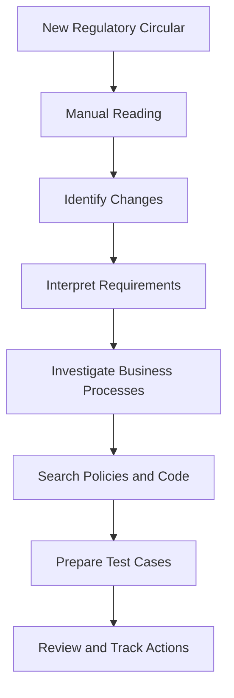

### The gap

Existing document question-answering systems can help explain text, but they do not necessarily connect a regulatory clause to specific code locations and tests.

RegulaLens AI focuses on closing this gap through **evidence-backed regulatory change-to-code impact analysis**.

## 3. Proposed Solution

RegulaLens AI processes regulatory documents and generates structured findings that engineers and compliance professionals can inspect.

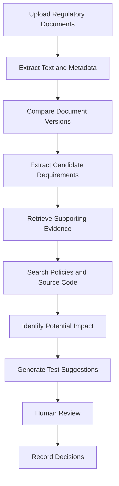

### Illustrative example

Suppose a hypothetical regulatory document changes a reporting interval from 30 days to 15 days.

RegulaLens AI could:

* Highlight the changed wording.
* Display relevant passages from both versions.
* Extract a candidate reporting requirement.
* Search a sample code repository for related reporting logic.
* Identify potentially relevant functions and existing tests.
* Suggest boundary-value and regression tests.
* Present evidence so a reviewer can verify the findings.

This is a hypothetical example, not a statement about an actual regulation.

## 4. Project Objectives

### Primary objectives

* Automate the initial processing of regulatory PDFs.
* Identify changes between document versions.
* Extract candidate requirements into structured records.
* Support evidence-backed question answering.
* Map requirements to potentially relevant software components.
* Generate draft test scenarios.
* Maintain traceability between source evidence and engineering recommendations.
* Evaluate AI output quality using repeatable tests.

### Non-objectives

RegulaLens AI is not intended to replace legal professionals, compliance teams, or software engineers.

It does not independently determine legal applicability, guarantee regulatory compliance, or make production code changes.

## 5. Key Features

| Feature                | Purpose                                                    |
| ---------------------- | ---------------------------------------------------------- |
| Document ingestion     | Register and process regulatory PDFs                       |
| PDF parsing            | Extract text and page references                           |
| Version comparison     | Identify candidate additions, deletions, and modifications |
| Requirement extraction | Convert passages into structured candidate requirements    |
| Semantic search        | Retrieve relevant text based on meaning                    |
| Evidence-backed Q&A    | Answer questions using retrieved source passages           |
| Impact analysis        | Identify potentially relevant code files and symbols       |
| Test generation        | Suggest test scenarios for engineering review              |
| Review dashboard       | Inspect and approve or reject findings                     |
| Traceability           | Connect clauses, requirements, code, and tests             |
| Evaluation suite       | Measure retrieval and answer quality                       |

**Project status:** RegulaLens AI is under development. The features described here represent the intended design and should not be interpreted as already implemented.

## 6. How RegulaLens AI Works

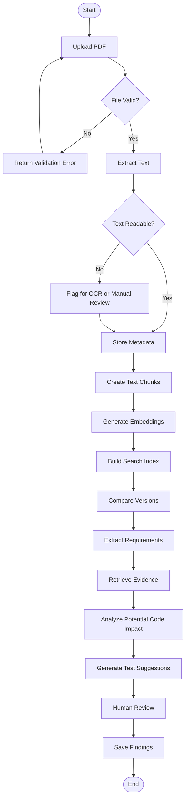

Each stage is intended to be independently testable, making it easier to debug the application and improve individual components.

## 7. Core Concepts

### 7.1 Large Language Models

LLMs process and generate natural language. In RegulaLens AI, they may help classify changes, extract requirements, explain source passages, identify possible code relationships, and draft tests.

Their output must be validated rather than treated as automatically correct.

### 7.2 Embeddings

Embeddings represent text as numerical vectors. Semantically related passages can have similar vectors, helping the system retrieve relevant information even when the wording differs.

### 7.3 Vector search

A vector index stores embeddings and supports similarity-based retrieval.

Chroma is a convenient option for a persistent local prototype. FAISS is another option for efficient similarity search.

### 7.4 Retrieval-Augmented Generation

RAG retrieves relevant passages before asking an LLM to generate an answer.

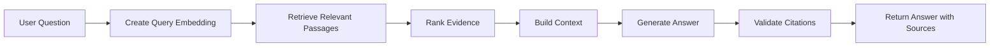

RAG can improve grounding, but it cannot guarantee that every generated claim is correct.

### 7.5 Static code analysis

Static analysis examines source code without executing it. The first implementation can use keyword search and file inspection before progressing to syntax-aware parsing and dependency analysis.

### 7.6 Human-in-the-loop AI

Human reviewers inspect AI findings, correct errors, and record decisions. This is particularly important when recommendations could influence compliance or production systems.

## 8. System Architecture

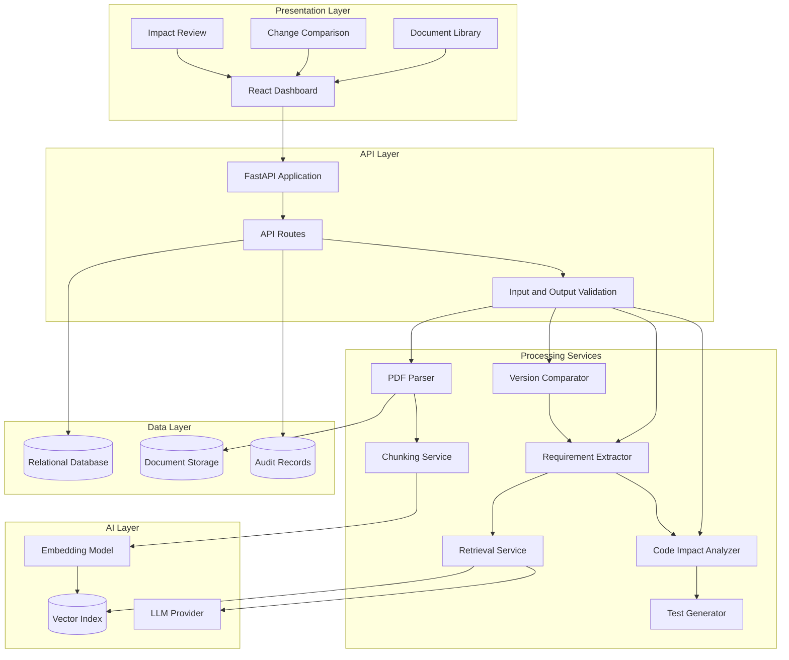

### Architectural principles

* Separate business logic from HTTP routes.
* Preserve document versions, page numbers, and source metadata.
* Link findings to evidence.
* Validate model outputs with explicit schemas.
* Keep application records separate from vector indexes.
* Record important human review decisions.
* Never apply generated code changes automatically.

## 9. Document Processing

### Step 1: Ingestion

Accept a PDF and register its metadata:

* Document title
* Issuing authority
* Publication date
* Source URL, where available
* Reference number or version
* File checksum
* Processing status

### Step 2: Text extraction

Use PyMuPDF to extract text from PDFs containing selectable text.

Scanned PDFs may require an OCR step.

### Step 3: Normalization

Remove unnecessary whitespace and extraction artifacts while preserving the original document for verification.

### Step 4: Chunking

Split extracted text into smaller passages for retrieval. Each chunk should retain its document ID, page number, section, and version.

### Step 5: Indexing

Generate embeddings for the chunks and store them alongside source metadata.

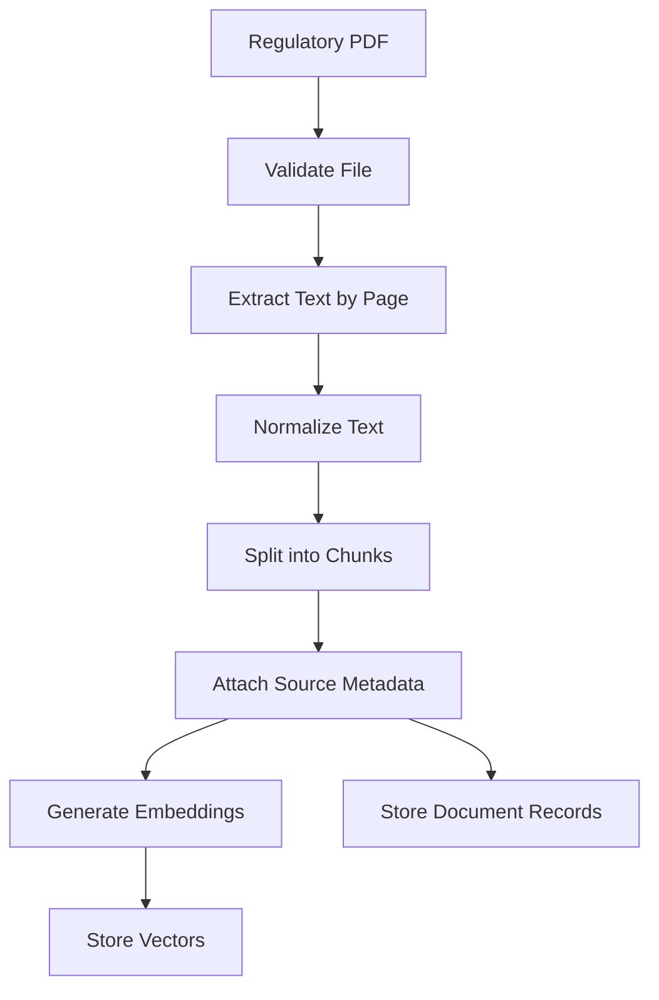

## 10. Regulatory Change Detection

The system compares an earlier document version with a newer one.

### Text comparison

Python's `difflib` can provide an initial implementation for identifying inserted, deleted, and modified text.

### Change classification

An LLM can help classify candidate differences as:

* New requirement
* Modified requirement
* Removed requirement
* Clarification
* Formatting-only change
* Uncertain classification

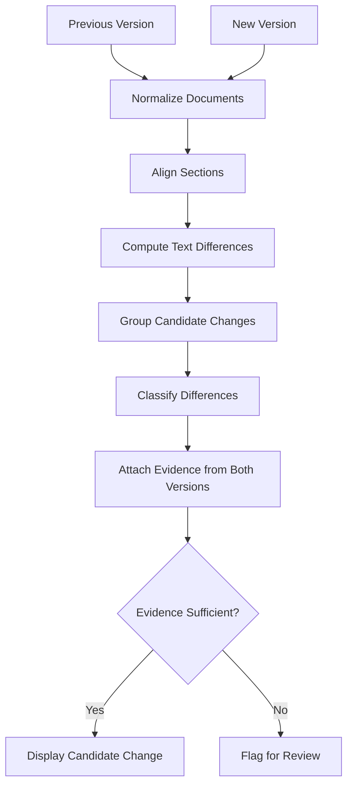

A textual difference does not necessarily indicate a substantive regulatory change. Numbering, formatting, and section reorganization can produce false positives.

## 11. RAG and Semantic Search

### Indexing pipeline

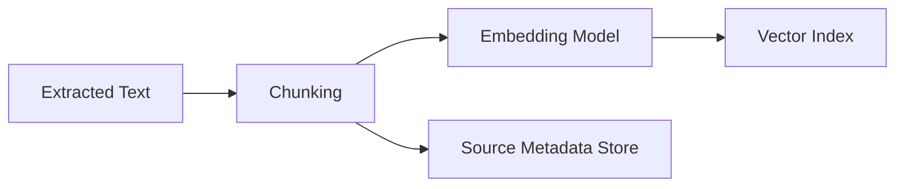

### Query pipeline

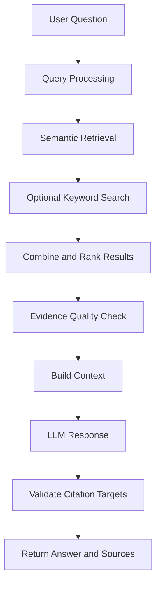

### Example evidence record

```json
{
  "document_id": "doc_001",
  "page": 8,
  "section": "Illustrative Section",
  "chunk_id": "chunk_014",
  "text": "Retrieved source passage"
}
```

Citation validation should confirm that the cited source exists and that the source passage supports the associated claim.

### Retrieval evaluation

Potential metrics include:

* Recall@k
* Precision@k
* Mean Reciprocal Rank
* Citation correctness
* Answer support by retrieved evidence

## 12. Requirement Extraction

The requirement extractor converts regulatory passages into structured candidate records.

### Example schema

```json
{
  "requirement_text": "Normalized candidate requirement",
  "requirement_type": "reporting",
  "source_document_id": "doc_001",
  "source_page": 8,
  "effective_date": null,
  "applicability_conditions": [],
  "review_status": "pending"
}
```

These values are illustrative. Unknown information should remain unknown rather than being invented.

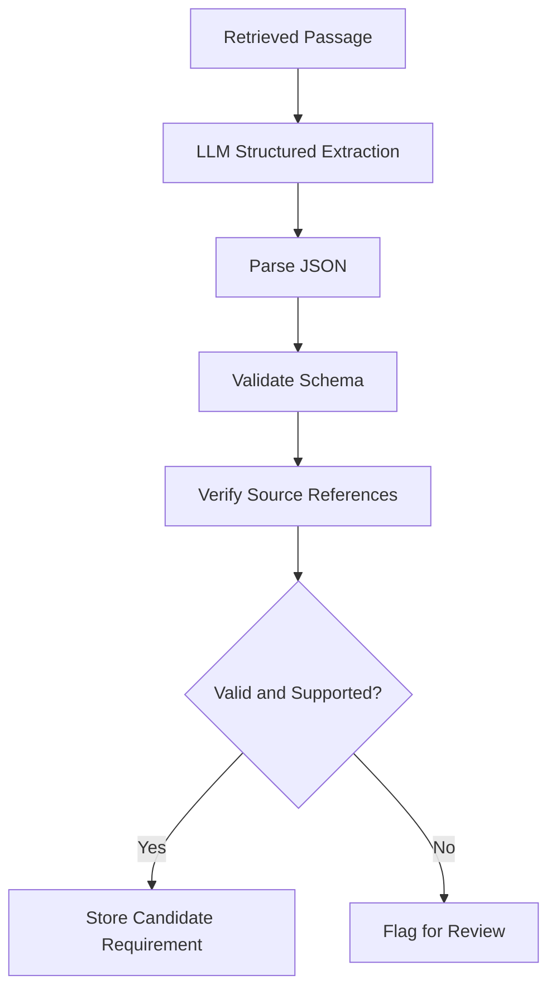

Schema validation confirms the structure of an output, not the truth of its contents. Semantic verification and human review are also necessary.

## 13. Software Impact Analysis

This is the primary engineering differentiator of RegulaLens AI.

The system investigates which parts of a sample software repository may be related to an extracted requirement.

### Initial analysis

The first implementation can search for:

* Relevant keywords and identifiers
* API routes
* Functions and classes
* Database models
* Configuration and validation logic
* Existing tests
* Related documentation

Later versions can introduce syntax-aware parsing and dependency graphs.

### Impact analysis workflow

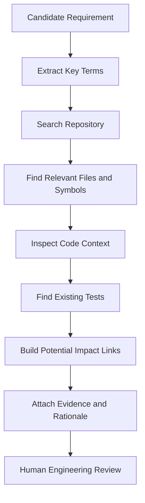

### Traceability chain

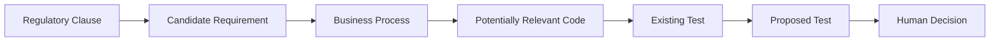

Each relationship should have a rationale and supporting evidence where available.

A matching keyword does not prove that a code component is affected. When evidence is insufficient, the system should explicitly mark the relationship as unresolved.

## 14. AI Test Generation

Once potentially relevant code has been identified, the system can suggest test scenarios for review.

### Test categories

* Positive tests
* Negative tests
* Boundary-value tests
* Input validation tests
* Regression tests
* Missing-data tests
* Error-handling tests

### Test generation workflow

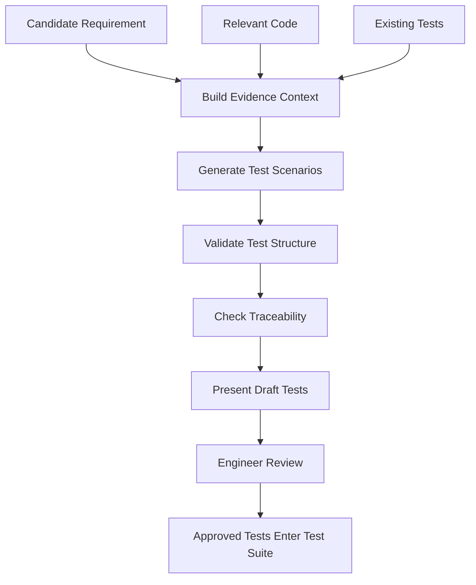

### Illustrative test

```python
def test_reporting_interval_boundary():
    reporting_interval = 15

    assert reporting_interval == 15
```

This example only demonstrates Python test syntax. A meaningful test must exercise the application's actual behavior and reflect a verified requirement.

Generated tests should not be added to production test suites without engineering review.

## 15. Human Review and Traceability

Every important finding should be inspectable and reviewable.

Reviewers should be able to examine:

* The original source document and page
* The previous and updated passages
* The extracted candidate requirement
* The relevant code references
* The impact rationale
* The proposed test cases
* The review decision and comments

### Review workflow

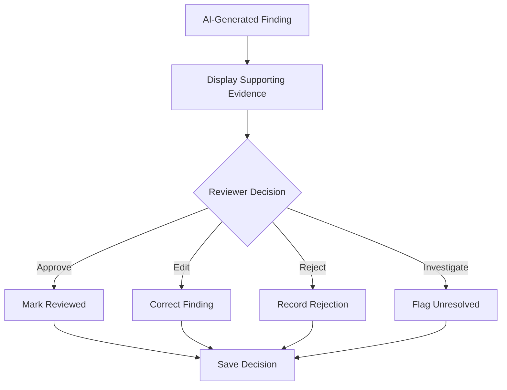

Possible review statuses:

* `pending`
* `approved`
* `edited`
* `rejected`
* `needs_investigation`

Approval records a review decision; it does not automatically certify regulatory compliance.

## 16. Database Design

The prototype can use SQLite for local development, with PostgreSQL as a future production-oriented option.

### Main entities

| Entity            | Purpose                                      |
| ----------------- | -------------------------------------------- |
| Documents         | Store document metadata                      |
| DocumentVersions  | Track document versions                      |
| Chunks            | Store extracted passages and page references |
| RegulatoryChanges | Store candidate differences                  |
| Requirements      | Store extracted requirements                 |
| CodeComponents    | Store discovered files and symbols           |
| ImpactLinks       | Connect requirements to candidate code       |
| TestSuggestions   | Store proposed tests                         |
| Reviews           | Store reviewer decisions                     |
| AuditEvents       | Record important system actions              |

### Entity relationship diagram

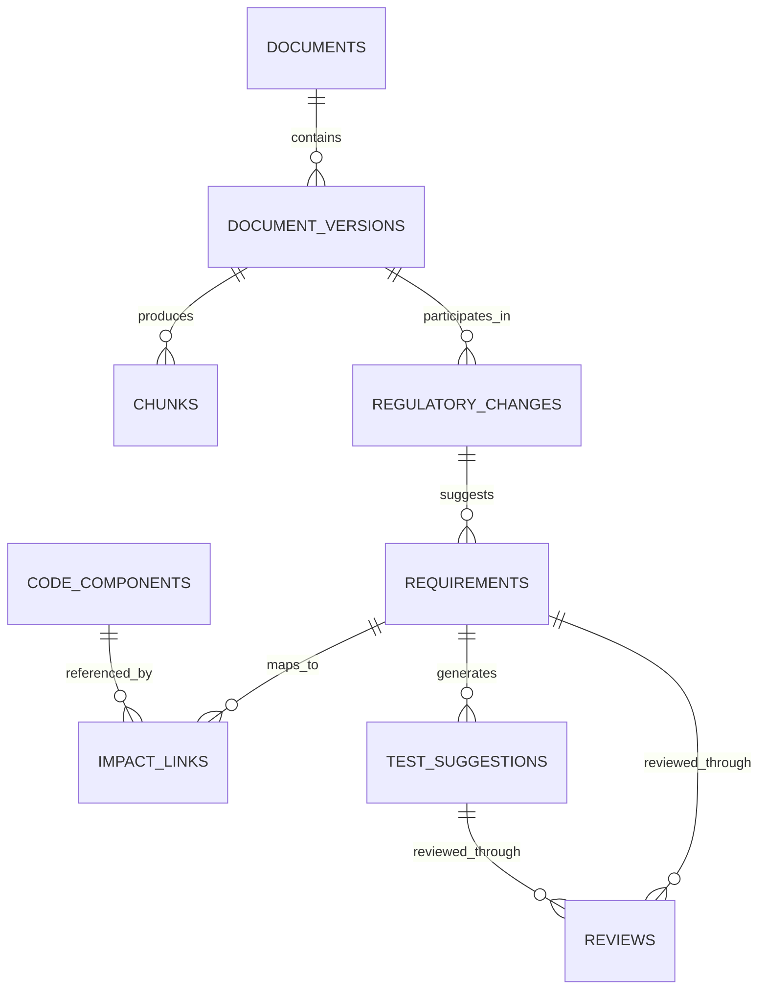

This is a proposed logical data model. Actual database tables may change during implementation.

## 17. API Design

The backend will use FastAPI to expose application operations.

| Method | Endpoint                | Purpose                             |
| ------ | ----------------------- | ----------------------------------- |
| `GET`  | `/health`               | Check API status                    |
| `POST` | `/documents/upload`     | Upload a PDF                        |
| `GET`  | `/documents`            | List documents                      |
| `GET`  | `/documents/{id}`       | Retrieve document metadata          |
| `POST` | `/documents/compare`    | Compare two document versions       |
| `POST` | `/search`               | Search regulatory passages          |
| `POST` | `/requirements/extract` | Extract candidate requirements      |
| `POST` | `/impact/analyze`       | Analyze potential repository impact |
| `POST` | `/tests/generate`       | Generate draft test suggestions     |
| `POST` | `/reviews`              | Record a review decision            |

These endpoints describe the intended API. They will become available as their corresponding backend routes are implemented.

## 18. Technology Stack

| Layer                | Technology               | Purpose                                |
| -------------------- | ------------------------ | -------------------------------------- |
| Programming language | Python                   | Core backend and AI logic              |
| Backend              | FastAPI                  | REST API                               |
| PDF processing       | PyMuPDF                  | Extract PDF text                       |
| Data validation      | Pydantic                 | Validate structured inputs and outputs |
| LLM integration      | Model provider API       | Requirement extraction and generation  |
| Embeddings           | Embedding model          | Represent text semantically            |
| Vector search        | Chroma or FAISS          | Retrieve relevant passages             |
| Text comparison      | Python `difflib`         | Initial document comparison            |
| Database             | SQLite, later PostgreSQL | Store application records              |
| Frontend             | React and Vite           | Interactive dashboard                  |
| Testing              | pytest                   | Automated testing                      |
| Version control      | Git and GitHub           | Source control and collaboration       |

The prototype should begin with a small number of dependencies and add complexity only when needed.

## 19. Project Structure

The planned repository structure is:

```text
RegulaLens-AI/
│
├── backend/
│   ├── app/
│   │   ├── __init__.py
│   │   ├── main.py
│   │   ├── config.py
│   │   │
│   │   ├── api/
│   │   │   ├── __init__.py
│   │   │   └── routes.py
│   │   │
│   │   ├── services/
│   │   │   ├── pdf_parser.py
│   │   │   ├── document_comparator.py
│   │   │   ├── chunker.py
│   │   │   ├── retrieval.py
│   │   │   ├── requirement_extractor.py
│   │   │   ├── impact_analyzer.py
│   │   │   └── test_generator.py
│   │   │
│   │   ├── models/
│   │   │   └── schemas.py
│   │   │
│   │   └── utils/
│   │       └── file_validation.py
│   │
│   ├── tests/
│   │   ├── test_health.py
│   │   ├── test_pdf_parser.py
│   │   └── test_comparator.py
│   │
│   ├── requirements.txt
│   └── .env.example
│
├── frontend/
│   ├── src/
│   │   ├── components/
│   │   ├── pages/
│   │   ├── services/
│   │   ├── App.jsx
│   │   └── main.jsx
│   └── package.json
│
├── sample_documents/
│   └── README.md
│
├── docs/
│   ├── architecture.md
│   └── evaluation.md
│
├── .gitignore
├── README.md
└── LICENSE
```

This is the target structure; directories and files can be added incrementally as features are built.

## 20. Installation and Setup

### Prerequisites

Install the following:

* Python 3.11 or later
* Git
* Visual Studio Code
* Node.js and npm, when starting frontend development

Verify the installations in PowerShell:

```powershell
python --version
git --version
```

For frontend development:

```powershell
node --version
npm --version
```

### Step 1: Clone the repository

If you have already cloned your repository, skip this step.

```powershell
git clone https://github.com/YOUR_USERNAME/RegulaLens-AI.git
cd RegulaLens-AI
```

Replace `YOUR_USERNAME` with your GitHub username.

### Step 2: Create a Python virtual environment

```powershell
cd backend
python -m venv .venv
```

Activate it in PowerShell:

```powershell
.\.venv\Scripts\Activate.ps1
```

If PowerShell blocks activation, you can use the environment's Python executable directly:

```powershell
.\.venv\Scripts\python.exe --version
```

### Step 3: Install backend dependencies

Create `backend/requirements.txt` with:

```text
fastapi
uvicorn[standard]
pymupdf
pydantic
python-dotenv
pytest
httpx
```

Install them:

```powershell
python -m pip install --upgrade pip
pip install -r requirements.txt
```

Additional dependencies for embeddings, vector search, or an LLM provider should be added when those features are implemented.

### Step 4: Return to the repository root

```powershell
cd ..
```

### Step 5: Create the project directories

From the repository root in PowerShell:

```powershell
New-Item -ItemType Directory -Force backend\app
New-Item -ItemType Directory -Force backend\app\api
New-Item -ItemType Directory -Force backend\app\services
New-Item -ItemType Directory -Force backend\app\models
New-Item -ItemType Directory -Force backend\app\utils
New-Item -ItemType Directory -Force backend\tests
New-Item -ItemType Directory -Force sample_documents
New-Item -ItemType Directory -Force docs
```

Create empty Python package files:

```powershell
New-Item -ItemType File -Force backend\app\__init__.py
New-Item -ItemType File -Force backend\app\api\__init__.py
```

If a file already exists, keep its contents rather than overwriting it.

## 21. Environment Variables

Create `backend/.env.example`:

```dotenv
APP_NAME=RegulaLens AI
APP_ENV=development
LLM_PROVIDER=
LLM_API_KEY=
EMBEDDING_MODEL=
VECTOR_STORE_PATH=./data/vector_store
```

Copy it to `backend/.env` when configuring a provider.

Keep `.env` out of version control. Never commit API keys or other secrets to GitHub.

The application should start without an LLM API key if only local features such as health checks and basic PDF processing are being tested.

## 22. Running the Application

### Step 1: Create a minimal FastAPI application

Create `backend/app/main.py`:

```python
from fastapi import FastAPI

app = FastAPI(
    title="RegulaLens AI",
    description="Regulatory intelligence and software impact analysis",
    version="0.1.0",
)


@app.get("/health")
def health_check():
    return {
        "status": "ok",
        "application": "RegulaLens AI",
    }
```

This is a minimal starting implementation, not the complete platform.

### Step 2: Start the backend

Open PowerShell at the repository root:

```powershell
cd backend
```

Activate the environment if necessary:

```powershell
.\.venv\Scripts\Activate.ps1
```

Run the server:

```powershell
uvicorn app.main:app --reload
```

### Step 3: Verify the application

Open these URLs in your browser:

* Health check: `http://127.0.0.1:8000/health`
* Interactive API documentation: `http://127.0.0.1:8000/docs`

The health endpoint should return:

```json
{
  "status": "ok",
  "application": "RegulaLens AI"
}
```

### Step 4: Start building features

Implement the project in this order:

1. PDF upload and text extraction.
2. Document metadata and page references.
3. Text comparison between two versions.
4. Chunking and semantic retrieval.
5. Requirement extraction.
6. Repository search and impact analysis.
7. Test generation.
8. Review dashboard and audit history.

Do not attempt to build the complete architecture in one step. Each stage should have working code and tests before the next stage is added.

## 23. Testing and Evaluation

Testing is important because fluent AI responses do not necessarily mean that the results are accurate.

### Traditional software tests

Use `pytest` for:

* PDF parsing
* Invalid file handling
* Text normalization
* Document comparison
* API input validation
* Structured output validation
* Error handling

Run tests from the backend directory:

```powershell
pytest
```

### AI evaluation

| Evaluation area        | Example measurement                                   |
| ---------------------- | ----------------------------------------------------- |
| Document extraction    | Percentage of expected text extracted                 |
| Change detection       | Precision and recall of identified changes            |
| Requirement extraction | Agreement with manually reviewed examples             |
| Retrieval              | Recall@k and ranking quality                          |
| Citation quality       | Whether references point to valid supporting passages |
| Impact analysis        | Precision of candidate code mappings                  |
| Test generation        | Requirement coverage and usefulness of suggestions    |

Create a small evaluation dataset containing sample documents, manually identified changes, expected requirements, and known relevant code components.

Record results before and after changing prompts, models, or retrieval settings.

## 24. Security and Responsible AI

Regulatory and source-code data can be sensitive. Security must be considered from the beginning.

### File security

* Validate file types and sizes.
* Use safe file handling and storage paths.
* Handle malformed PDFs gracefully.
* Avoid executing uploaded files.
* Consider OCR and document-processing resource limits.

### API and secret security

* Keep API keys in environment variables or a secrets manager.
* Never commit credentials.
* Add authentication before exposing sensitive data.
* Apply upload limits and request validation.
* Avoid exposing internal server errors or secret values.

### AI security

* Treat document content as untrusted input.
* Defend against prompt injection inside uploaded documents.
* Do not allow document instructions to override system controls.
* Validate generated structured output.
* Verify citations against stored source passages.
* Treat code impact links as hypotheses until reviewed.
* Never automatically execute generated code or tests against production systems.

### Regulatory responsibility

The application provides decision support. Qualified professionals must verify legal interpretation, applicability, deadlines, and implementation decisions.

## 25. Development Roadmap

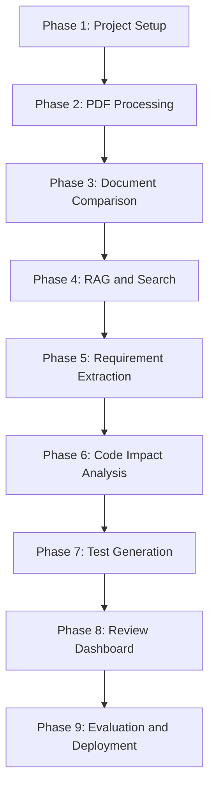

### Phase 1 — Foundation

* Create the repository structure.
* Set up FastAPI.
* Configure the virtual environment.
* Add a health endpoint.
* Establish basic tests.

### Phase 2 — Document processing

* Upload PDFs.
* Extract page-level text.
* Validate files.
* Preserve document metadata.
* Handle unreadable documents.

### Phase 3 — Regulatory comparison

* Register multiple document versions.
* Compare extracted text.
* Highlight candidate changes.
* Link changes to original pages.

### Phase 4 — RAG

* Implement chunking.
* Generate embeddings.
* Add a vector index.
* Retrieve relevant source passages.
* Return answers with source references.

### Phase 5 — Requirement extraction

* Define requirement schemas.
* Extract candidate requirements.
* Validate model output.
* Attach supporting evidence.
* Flag uncertain results.

### Phase 6 — Code impact analysis

* Accept or configure a sample repository.
* Search files and symbols.
* Identify potentially relevant code.
* Link findings to candidate requirements.
* Record uncertainty and rationale.

### Phase 7 — Test generation

* Inspect existing tests.
* Generate draft scenarios.
* Validate output structure.
* Add traceability to requirements.
* Require engineering review.

### Phase 8 — Frontend

* Build the document library.
* Display version differences.
* Show extracted requirements.
* Present impact findings and suggested tests.
* Add reviewer decisions.

### Phase 9 — Evaluation and deployment

* Create a repeatable evaluation dataset.
* Measure retrieval and citation quality.
* Improve failure handling.
* Add authentication and operational logging.
* Deploy the prototype.

## 26. Future Enhancements

Potential future improvements include:

* Automated monitoring of official regulatory sources.
* Support for multiple regulators and document formats.
* OCR for scanned documents.
* Hybrid keyword and semantic retrieval.
* More advanced document alignment.
* AST-based source-code analysis.
* Dependency graph generation.
* Integration with GitHub pull requests.
* Integration with issue-tracking systems.
* Reviewer feedback loops.
* Role-based access control.
* Versioned analysis reports.
* Evaluation dashboards.
* Support for additional programming languages.

These are future possibilities, not current capabilities.

## 27. Limitations

RegulaLens AI has important limitations:

* PDF extraction may fail on scanned or poorly formatted documents.
* Text differences may not capture the legal significance of a change.
* LLMs can generate incorrect or unsupported interpretations.
* Semantic similarity does not prove that a code component is affected.
* Repository search may miss indirect dependencies.
* Suggested tests may be incomplete or technically incorrect.
* Applicability depends on the organization's circumstances.
* Regulatory coverage depends on the documents available to the system.

The system should clearly communicate uncertainty and allow unresolved findings rather than fabricate relationships.

## 28. Contributing

Contributions and suggestions are welcome.

### Contribution workflow

1. Fork the repository.
2. Create a feature branch.
3. Make a focused change.
4. Add or update tests.
5. Run the test suite.
6. Submit a pull request with a clear description.

Example:

```bash
git checkout -b feature/document-comparison
git add .
git commit -m "Add document comparison"
git push origin feature/document-comparison
```

Please avoid committing API keys, private regulatory materials, personal information, or proprietary source code.

## 29. License

The project license will be specified in the repository's `LICENSE` file.

Until a license is added, do not assume that others have permission to reuse, distribute, or modify the code.

---

## Final Note

RegulaLens AI is an evolving project exploring how AI can connect regulatory evidence with practical software engineering workflows.

Its core design principle is **traceability over unsupported automation**: every proposed requirement, code relationship, and test recommendation should be inspectable, evidence-backed, and subject to human review.

The long-term goal is to move beyond regulatory question answering and build a reliable bridge between regulatory change and engineering action.
