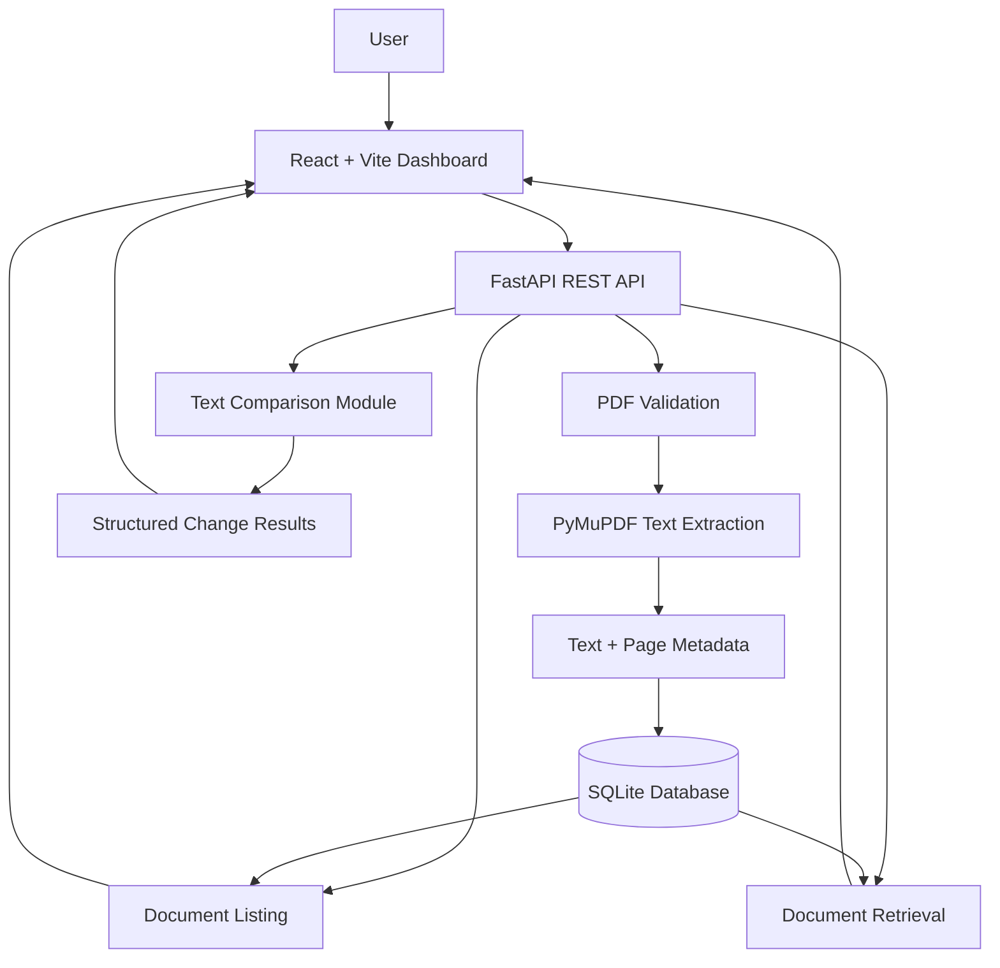
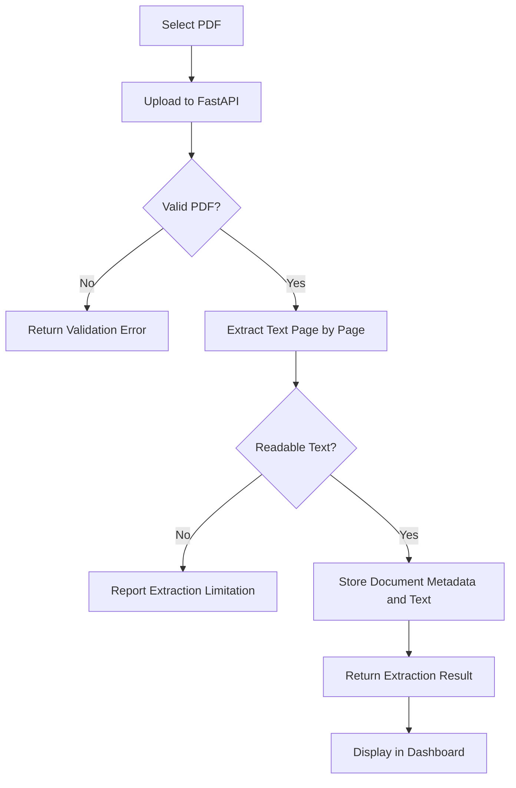
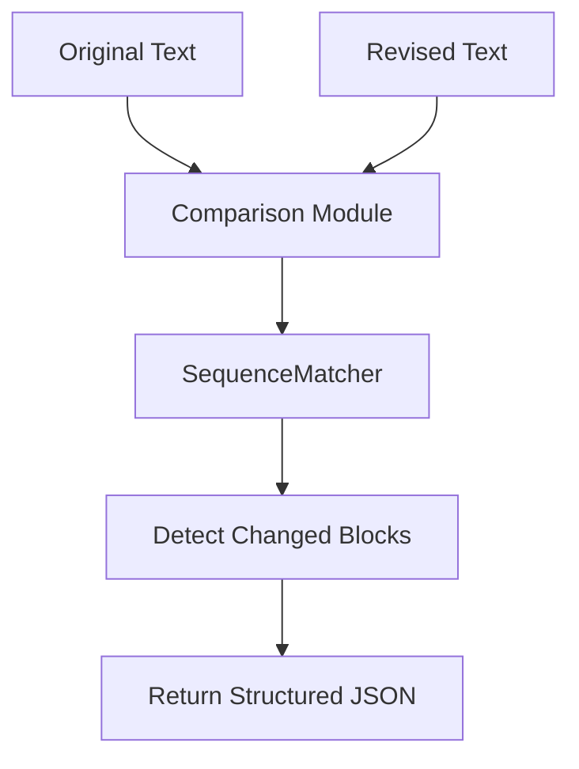
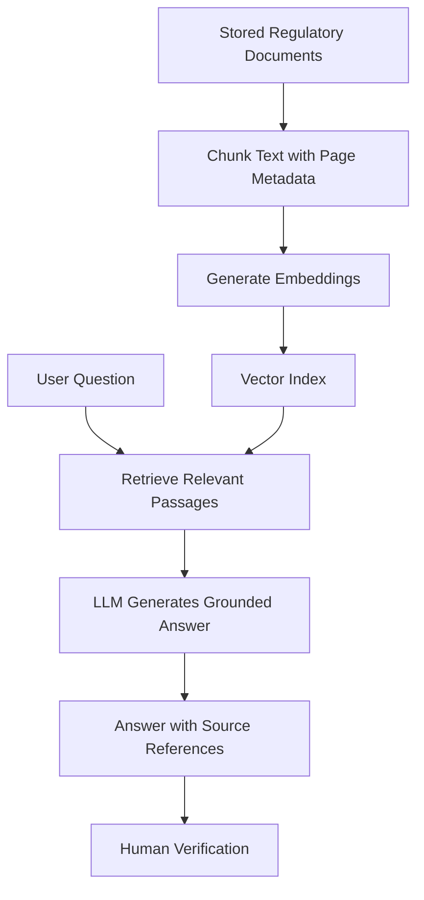

# RegulaLens AI

**Regulatory Intelligence • Document Analysis • Change Detection**

RegulaLens AI is a regulatory intelligence platform designed to simplify the analysis of regulatory documents, including public circulars and notifications from organizations such as the Reserve Bank of India (RBI) and the Securities and Exchange Board of India (SEBI).

The project combines a React dashboard with a FastAPI backend to support PDF ingestion, text extraction, document storage, and regulatory text comparison. The long-term goal is to build an evidence-grounded intelligence system that helps users understand regulatory changes and identify requirements that may need further review.

> **Project status:** Under active development. PDF extraction, SQLite document persistence, document retrieval APIs, a React dashboard, and a text-based comparison module are implemented. Citation-backed RAG, automated monitoring, and evidence-based impact analysis remain in development.

---

## Table of Contents

- [Overview](#overview)
- [Problem Statement](#problem-statement)
- [Key Features](#key-features)
- [Technology Stack](#technology-stack)
- [System Architecture](#system-architecture)
- [Application Workflow](#application-workflow)
- [Project Structure](#project-structure)
- [Getting Started](#getting-started)
- [API Reference](#api-reference)
- [Document Comparison](#document-comparison)
- [Testing](#testing)
- [Current Limitations](#current-limitations)
- [Roadmap](#roadmap)
- [Contributing](#contributing)
- [Disclaimer](#disclaimer)

---

## Overview

Regulatory documents can be lengthy, technical, and difficult to compare across versions. Manually reviewing these documents makes it challenging to identify changed requirements, maintain document history, and determine which areas require additional attention.

RegulaLens AI aims to make this process more manageable through a centralized document workspace and a modular backend.

The platform is being developed around four core capabilities:

1. **Document ingestion:** Upload regulatory PDFs and extract readable text.
2. **Document management:** Store and retrieve document metadata and extracted content.
3. **Change detection:** Identify textual differences between document versions.
4. **Regulatory intelligence:** Progress toward source-grounded question answering and impact analysis.

## Key Features

### 1. Regulatory Document Ingestion

- Upload PDF files through the FastAPI backend.
- Validate uploaded file types and enforce a 10 MB file-size limit.
- Extract readable text using PyMuPDF.
- Process documents page by page.
- Preserve page-level text and document metadata for traceability.

### 2. Document Storage and Retrieval

- Persist document records using SQLite.
- Store document metadata, page count, and extracted content.
- List previously uploaded documents.
- Retrieve individual document records through REST API endpoints.

### 3. Interactive Dashboard

The React frontend provides a workspace for navigating the document-processing and planned intelligence workflows.

- **Overview:** Dashboard metrics, backend connection status, recent documents, and workflow shortcuts.
- **Documents:** PDF upload, document search, document listing, and extracted-text inspection.
- **Change Monitor:** Interface for selecting documents and reviewing comparison results; end-to-end integration with stored-document comparison is still being aligned with the backend API.
- **Ask RegulaLens:** Conversational question-and-answer interface scaffold for future document-grounded retrieval.
- **Impact Analysis:** Interface for capturing regulatory requirements for future evidence-backed review.

The frontend is under active development. The presence of an interface does not mean every underlying AI workflow is implemented.

### 4. Text-Based Document Comparison

- Compare two supplied text versions.
- Detect inserted, deleted, and replaced text blocks.
- Return structured JSON describing detected changes.
- Keep the comparison logic separate from the API layer.

The current comparison engine identifies textual differences. It does not independently determine whether a change alters a legal obligation or compliance status.

### 5. API Documentation

- REST APIs built with FastAPI.
- Interactive API documentation through Swagger UI.
- Endpoints that can be tested independently of the frontend.

---

## Technology Stack

| Component | Technology |
|---|---|
| Frontend | React, Vite, JavaScript |
| UI icons | Lucide React |
| Styling | CSS |
| Backend | Python, FastAPI |
| PDF processing | PyMuPDF |
| Database | SQLite |
| Text comparison | Python `difflib` |
| API validation | Pydantic |
| API documentation | OpenAPI, Swagger UI |
| Version control | Git, GitHub |

### Planned AI technologies

The following technologies are candidates for future implementation, not a claim about the current runtime:

- Retrieval-Augmented Generation (RAG)
- Text chunking and metadata-aware retrieval
- Embeddings and vector search
- Large language models for evidence-grounded answers
- Source-page citations and regulatory impact review

---

## System Architecture

The current architecture separates the frontend, backend API, document extraction, persistence, and comparison logic.



The diagram describes the main backend components and the intended frontend integration. The document comparison API currently compares supplied text; automatically loading two stored documents and comparing them remains a follow-up integration task.

## Application Workflow

### PDF ingestion



### Text comparison



### Planned RAG workflow



The RAG workflow is a planned architecture and is not yet implemented end to end.

---

## Project Structure

```text
regulalens-ai/
├── backend/
│   └── app/
│       ├── main.py
│       ├── database.py
│       ├── document_comparison.py
│       └── regulalens.db
├── frontend/
│   ├── src/
│   │   ├── assets/
│   │   ├── App.jsx
│   │   ├── App.css
│   │   ├── index.css
│   │   └── main.jsx
│   ├── package.json
│   └── package-lock.json
├── test_document_comparison.py
├── requirements.txt
├── README.md
└── .gitignore
```

The exact files may evolve as the project grows. The SQLite database is generated application data; avoid committing local databases containing personal, confidential, or otherwise sensitive documents.

---

## Getting Started

### Prerequisites

Install:

- Python 3.10 or later
- Node.js and npm
- Git
- A code editor such as Visual Studio Code

### 1. Clone the repository

```bash
git clone https://github.com/rajshreesinha-23/regulalens-ai.git
cd regulalens-ai
```

### 2. Create a Python virtual environment

On Windows PowerShell:

```powershell
python -m venv .venv
.\.venv\Scripts\Activate.ps1
```

If environment activation is unavailable, use the virtual environment's Python executable directly.

### 3. Install backend dependencies

```powershell
python -m pip install -r requirements.txt
```

### 4. Start the backend

From the repository root:

```powershell
python -m uvicorn backend.app.main:app --reload
```

The backend should be available at:

- API base URL: `http://127.0.0.1:8000`
- Swagger UI: `http://127.0.0.1:8000/docs`
- Health check: `http://127.0.0.1:8000/health`

### 5. Start the frontend

Open a second terminal:

```powershell
cd frontend
npm install
npm run dev
```

Open the development URL printed by Vite, usually:

`http://localhost:5173`

The frontend uses `http://127.0.0.1:8000` as its API base URL. Ensure the backend is running and that its CORS configuration permits requests from the frontend development origin.

---

## API Reference

Open `http://127.0.0.1:8000/docs` after starting the backend to inspect the actual endpoint schemas and test requests.

| Method | Endpoint | Purpose |
|---|---|---|
| `GET` | `/` | Welcome endpoint |
| `GET` | `/health` | Backend health check |
| `POST` | `/documents/extract` | Upload a PDF and extract its text |
| `GET` | `/documents` | List stored documents |
| `GET` | `/documents/{document_id}` | Retrieve a stored document |
| `POST` | `/documents/compare` | Compare supplied text versions |

### Example: Extract a PDF

Send a `multipart/form-data` request to:

```http
POST /documents/extract
```

Use the `file` field to upload a PDF. The backend validates the file and returns the extraction result according to its response schema.

### Example: List documents

```http
GET /documents
```

Returns the document records available through the backend.

### Example: Compare text

```http
POST /documents/compare
```

Example request body:

```json
{
  "old_text": "Reports must be submitted monthly.",
  "new_text": "Reports must be submitted weekly."
}
```

Use Swagger UI to confirm the exact request and response schema if it differs from this example.

---

## Document Comparison

The comparison module is located at:

`backend/app/document_comparison.py`

Its core function is:

```python
compare_documents(old_text, new_text)
```

Example:

```python
from backend.app.document_comparison import compare_documents

old_text = "Reports must be submitted monthly."
new_text = "Reports must be submitted weekly."

result = compare_documents(old_text, new_text)
print(result)
```

A representative result is:

```json
{
  "total_changes": 1,
  "changes": [
    {
      "type": "replace",
      "old_text": "Reports must be submitted monthly.",
      "new_text": "Reports must be submitted weekly."
    }
  ]
}
```

The comparison module uses textual similarity and sequence comparison to identify changed blocks. `total_changes` represents detected change blocks, not the number of legal obligations affected.

---

## Testing

### Test the comparison module

From the repository root:

```powershell
python test_document_comparison.py
```

### Test the API

1. Start the FastAPI server.
2. Open `http://127.0.0.1:8000/docs`.
3. Test `GET /health`.
4. Upload a readable PDF through `POST /documents/extract`.
5. Verify document listing and retrieval.
6. Submit sample text to `POST /documents/compare`.

Test the backend endpoints independently before relying on their integration with the dashboard.

---

## Current Limitations

RegulaLens AI is an evolving project. Current limitations include:

- Scanned PDFs requiring OCR are not yet supported by a dedicated OCR pipeline.
- Document comparison works on supplied text rather than automatically comparing stored versions by document ID.
- Textual changes are not necessarily changes in regulatory meaning.
- The dashboard's comparison interface still needs to be aligned with the comparison API.
- The Ask RegulaLens interface is a scaffold; a complete RAG pipeline and question-answering backend are not yet implemented.
- Impact Analysis currently captures input but does not generate an evidence-backed compliance assessment.
- Automated monitoring of RBI, SEBI, or other regulatory sources is not yet implemented.
- Authentication, access controls, and production deployment require further work.

## Roadmap

### Phase 1 — Document ingestion and persistence

- [x] FastAPI application setup
- [x] PDF upload and validation
- [x] Page-level text extraction
- [x] SQLite persistence
- [x] Document listing and retrieval endpoints

### Phase 2 — Comparison and dashboard integration

- [x] Standalone text comparison module
- [x] Detect inserted, deleted, and replaced text blocks
- [x] Comparison API
- [x] Basic comparison test script
- [ ] Compare stored document versions by ID
- [ ] Integrate the comparison workflow with the dashboard
- [ ] Improve change grouping and reporting

### Phase 3 — Retrieval-Augmented Generation

- [ ] Chunk extracted text with page-level metadata
- [ ] Generate embeddings for document passages
- [ ] Implement vector search
- [ ] Retrieve relevant passages for a user question
- [ ] Generate source-grounded answers
- [ ] Return document and page references
- [ ] Evaluate retrieval quality and answer grounding

### Phase 4 — Regulatory intelligence

- [ ] Compare related circular versions
- [ ] Explain the significance of detected changes
- [ ] Identify potentially affected requirements
- [ ] Produce evidence-backed review suggestions
- [ ] Keep human verification in the workflow

### Phase 5 — Monitoring and deployment

- [ ] Integrate reliable public regulatory sources
- [ ] Track document versions and publication dates
- [ ] Automate change-monitoring workflows
- [ ] Add authentication and access controls
- [ ] Expand automated test coverage
- [ ] Deploy the application

---

## Contributing

Suggestions, bug reports, and contributions are welcome.

1. Fork the repository.
2. Create a feature branch.
3. Make a focused change.
4. Run the relevant tests.
5. Submit a pull request with a clear description.

```bash
git checkout -b feature/your-feature
git add .
git commit -m "Describe your change"
git push origin feature/your-feature
```

Do not commit credentials, virtual environments, or confidential document data.

## Disclaimer

RegulaLens AI is a software development project intended to assist with regulatory document processing and analysis. It is not an official regulatory platform, legal advice, or a compliance certification system.

Any future AI-generated findings should be verified against the original regulatory documents and reviewed by qualified professionals before being used for compliance decisions.

---

**Built with React, FastAPI, Python, and a focus on evidence-grounded regulatory intelligence.**
