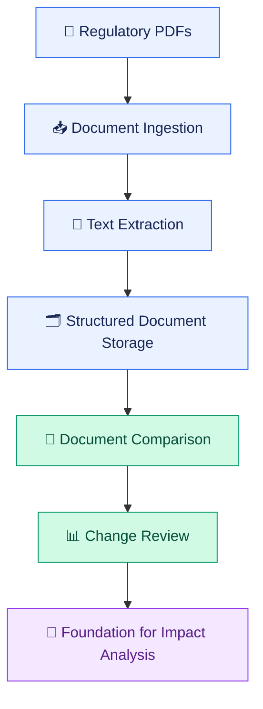
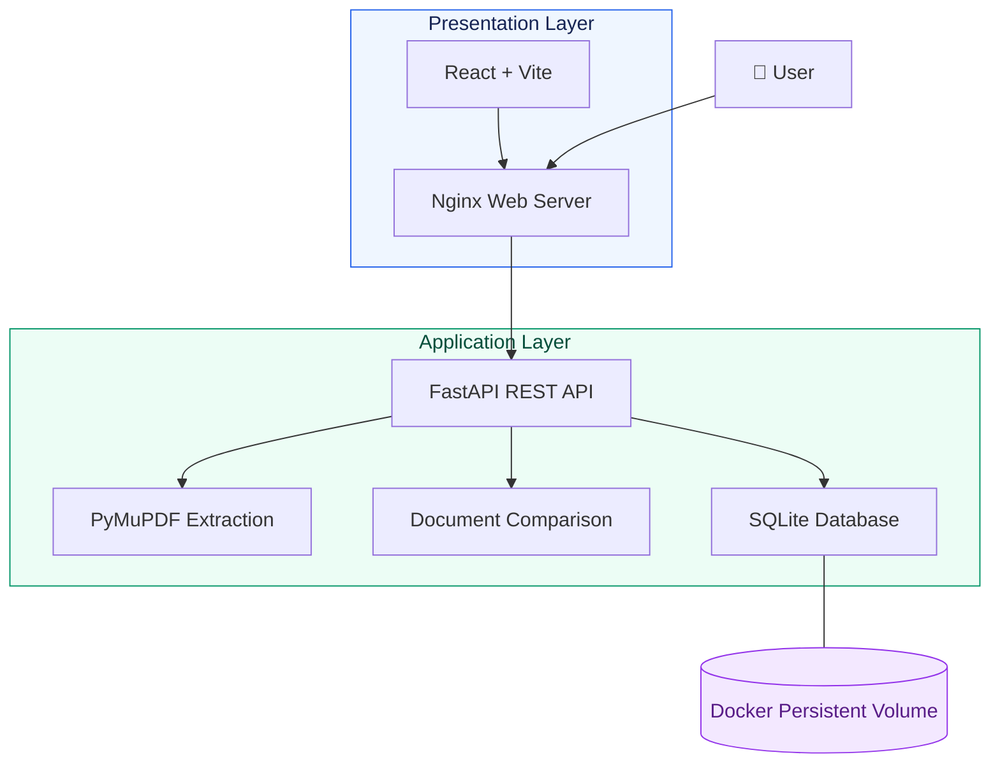
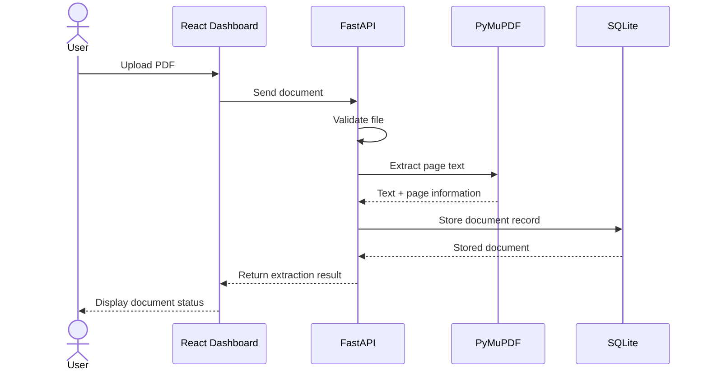
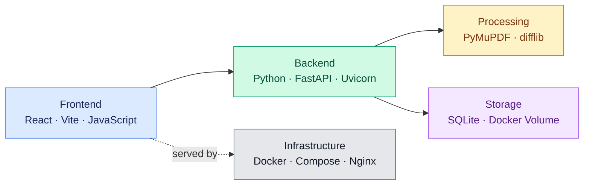

# RegulaLens AI

### AI-Powered Regulatory Intelligence & Software Impact Analysis

**Turning complex regulatory documents into structured, actionable intelligence.**

RegulaLens AI is a regulatory document intelligence platform built to process PDFs, extract page-aware text, compare regulatory documents, and provide a foundation for AI-assisted compliance workflows.

<p align="center">
  
  
  
  
  
</p>

---

## 🧭 Project Overview



## ✨ Core Capabilities

| Capability | Description | Status |
|---|---|---|
| 📄 PDF ingestion | Upload regulatory documents through the API | Implemented |
| 🔎 Text extraction | Extract page-aware text with PyMuPDF | Implemented |
| 🗃️ Document storage | Store metadata and extracted content in SQLite | Implemented |
| 🔄 Document comparison | Identify inserted, deleted, and replaced text | Implemented |
| 🖥️ Web dashboard | React/Vite frontend for document workflows | Implemented |
| 🐳 Docker deployment | Run frontend and backend with Docker Compose | Configured |
| 🧠 RAG question answering | Retrieve relevant passages for grounded answers | Planned |
| 🎯 Automated impact analysis | Map regulatory changes to affected systems | Planned |

## 🏛️ System Architecture



**Architecture at a glance**

- **Frontend:** React and Vite, served through Nginx.
- **Backend:** FastAPI exposes document processing and comparison endpoints.
- **Processing:** PyMuPDF extracts PDF text while retaining page information.
- **Storage:** SQLite stores document records and extracted content.
- **Infrastructure:** Docker Compose coordinates the frontend and backend services.

## 🔁 Document Processing Workflow



## 🧰 Technology Stack



## 🚀 Run Locally with Docker

### Prerequisites

- Git
- Docker Desktop
- Docker Compose

### 1. Clone the repository

```bash
git clone https://github.com/rajshreesinha-23/regulalens-ai.git
cd regulalens-ai
```

### 2. Start the application

```bash
docker compose up --build -d
```

### 3. Access the services

| Service | URL |
|---|---|
| Frontend Dashboard | [localhost:3000](http://localhost:3000) |
| Backend API | [localhost:8000](http://localhost:8000) |
| Swagger API Docs | [localhost:8000/docs](http://localhost:8000/docs) |
| Health Check | [localhost:8000/health](http://localhost:8000/health) |

### 4. Useful commands

```bash
# Check running services
docker compose ps

# Follow application logs
docker compose logs -f

# Stop services; keep named volumes
docker compose down

# Rebuild and restart after code changes
docker compose up --build -d
```

## 🗺️ Roadmap

```mermaid
flowchart LR
    A["✅ PDF Ingestion"] --> B["✅ Extraction & Storage"]
    B --> C["✅ Text Comparison"]
    C --> D["✅ Docker Setup"]
    D --> E["🔜 Retrieval-Augmented Generation"]
    E --> F["🔜 Citation-Grounded Answers"]
    F --> G["🔜 Regulatory Impact Mapping"]
    G --> H["🔜 Monitoring & Alerts"]

    style A fill:#D1FAE5,stroke:#059669,color:#064E3B
    style B fill:#D1FAE5,stroke:#059669,color:#064E3B
    style C fill:#D1FAE5,stroke:#059669,color:#064E3B
    style D fill:#D1FAE5,stroke:#059669,color:#064E3B
    style E fill:#DBEAFE,stroke:#2563EB,color:#172554
    style F fill:#DBEAFE,stroke:#2563EB,color:#172554
    style G fill:#F3E8FF,stroke:#9333EA,color:#581C87
    style H fill:#F3E8FF,stroke:#9333EA,color:#581C87
```



*The roadmap distinguishes existing functionality from planned AI capabilities.*

## 📁 Repository Structure

```text
regulalens-ai/
├── backend/
│   ├── app/
│   │   ├── main.py
│   │   ├── database.py
│   │   ├── document_chunker.py
│   │   ├── document_comparator.py
│   │   └── ...
│   └── tests/
├── frontend/
│   ├── public/
│   ├── src/
│   ├── Dockerfile
│   ├── nginx.conf
│   ├── package.json
│   └── vite.config.js
├── docs/
├── sample_data/
├── Dockerfile.backend
├── docker-compose.yml
├── requirements.txt
└── README.md
```

## 🎯 Project Vision

RegulaLens AI is being developed to bridge regulatory document processing with software impact analysis. Its foundation combines structured extraction, persistent storage, and document comparison, with future work focused on retrieval-augmented generation, source-grounded answers, and more automated regulatory intelligence.

## 🤝 Contributing

Suggestions, issues, and contributions are welcome. Fork the repository, create a feature branch, and submit a pull request with a clear description of your changes.

## 📄 License

A license will be specified when one is selected for the repository.
