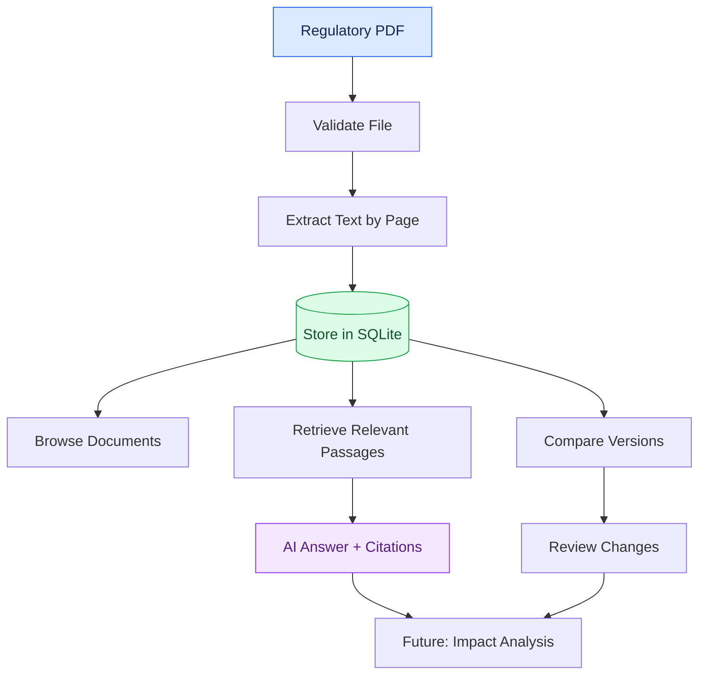
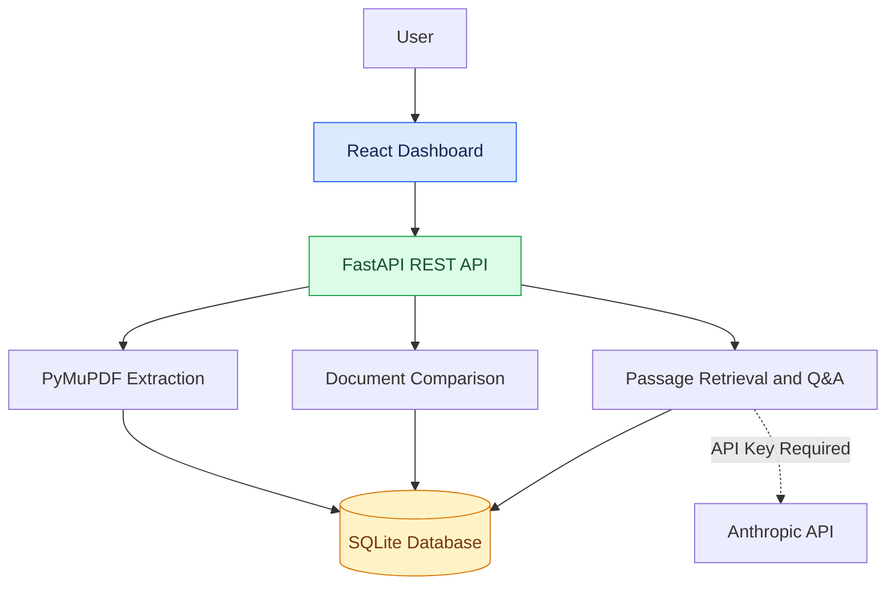
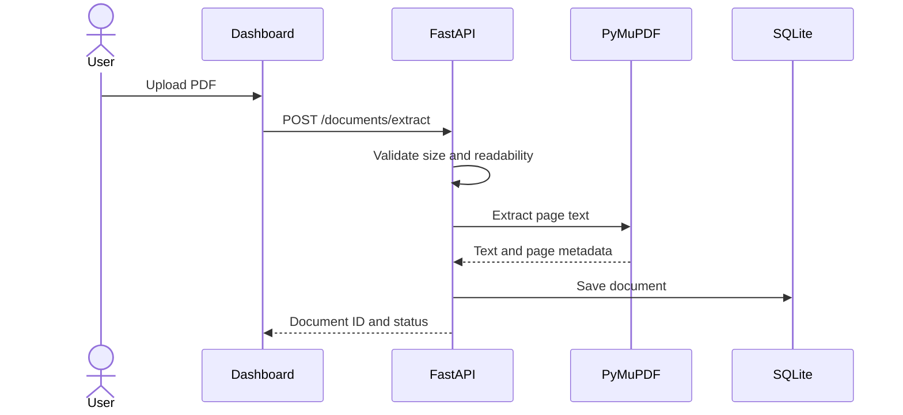
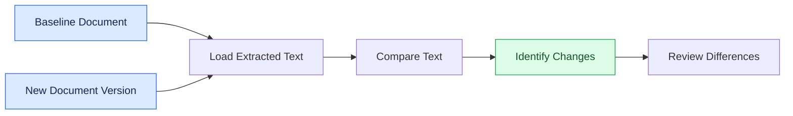
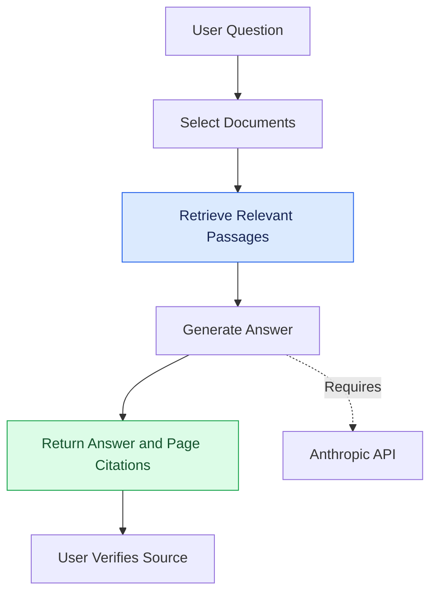

# RegulaLens AI
### AI-Powered Regulatory Intelligence & Software Impact Analysis

**Turn regulatory PDFs into structured, comparable, and searchable intelligence.**

RegulaLens AI helps users extract regulatory documents, compare versions, and retrieve relevant passages for AI-assisted question answering.

<p align="center">
  
  
  
  
</p>

---

## 🔍 How It Works



## 🏗️ System Architecture



## ⚙️ Core Workflows

### 1. PDF Ingestion



### 2. Regulatory Version Comparison



### 3. AI-Powered Document Q&A



## ✨ Features

| Feature | Status |
|---|---|
| PDF upload and validation | Implemented |
| Page-wise text extraction | Implemented |
| SQLite document storage | Implemented |
| Document version comparison | Implemented |
| React dashboard | Implemented; evolving |
| AI Q&A with citation data | Backend available; API key required |
| OCR for scanned PDFs | Planned |
| Automated software impact analysis | Planned |
| Regulatory monitoring and alerts | Planned |

## 🛠️ Technology Stack

- **Frontend:** React, Vite, JavaScript
- **Backend:** Python, FastAPI, Uvicorn
- **PDF Processing:** PyMuPDF
- **Comparison:** Python text-difference utilities
- **Database:** SQLite
- **AI Integration:** Anthropic API
- **Deployment:** Docker Compose, Nginx

## 🚀 Getting Started

### Prerequisites

- Git
- Docker Desktop
- Docker Compose

### Installation

```bash
git clone https://github.com/rajshreesinha-23/regulalens-ai.git
cd regulalens-ai
docker compose up --build -d
```

### Application URLs

| Service | URL |
|---|---|
| Dashboard | http://localhost:3000 |
| Backend API | http://localhost:8000 |
| Swagger API Docs | http://localhost:8000/docs |
| Health Check | http://localhost:8000/health |

### Useful Commands

```bash
docker compose ps
docker compose logs -f
docker compose down
docker compose up --build -d
```

## 🔌 API Endpoints

| Method | Endpoint | Description |
|---|---|---|
| GET | `/health` | Check API health |
| POST | `/documents/extract` | Upload and extract a PDF |
| GET | `/documents` | List saved documents |
| GET | `/documents/{document_id}` | Retrieve a document |
| POST | `/documents/compare` | Compare two document versions |
| POST | `/ask` | Ask questions about saved documents |

Explore the endpoints at **http://localhost:8000/docs** after starting the application.

**AI configuration:** Set `ANTHROPIC_API_KEY` in the backend environment to enable AI-generated answers. Never commit API keys or other secrets to GitHub.

## 🗺️ Project Roadmap

```mermaid
flowchart LR
    A[PDF Ingestion] --> B[Document Storage]
    B --> C[Version Comparison]
    C --> D[Improve Q&A Workflow]
    D --> E[OCR Support]
    E --> F[Software Impact Analysis]
    F --> G[Regulatory Monitoring]

    style A fill:#dcfce7,stroke:#16a34a,color:#14532d
    style B fill:#dcfce7,stroke:#16a34a,color:#14532d
    style C fill:#dcfce7,stroke:#16a34a,color:#14532d
    style D fill:#dbeafe,stroke:#2563eb,color:#172554
    style E fill:#f3e8ff,stroke:#9333ea,color:#581c87
    style F fill:#f3e8ff,stroke:#9333ea,color:#581c87
```



## ⚠️ Limitations

- Maximum PDF upload size: **10 MB**.
- Scanned PDFs may require OCR, which is not yet implemented.
- AI question answering requires a valid Anthropic API key and external service availability.
- Text comparison identifies differences but does not independently determine their legal significance.
- Automated software impact analysis remains a future development goal.

RegulaLens AI is a development project and does not replace professional legal or regulatory review. Always verify important conclusions against the original documents.

## 🤝 Contributing

Contributions and suggestions are welcome. Fork the repository, create a feature branch, test your changes, and submit a pull request describing your contribution.

## 📄 License

No license is currently specified for this repository.
