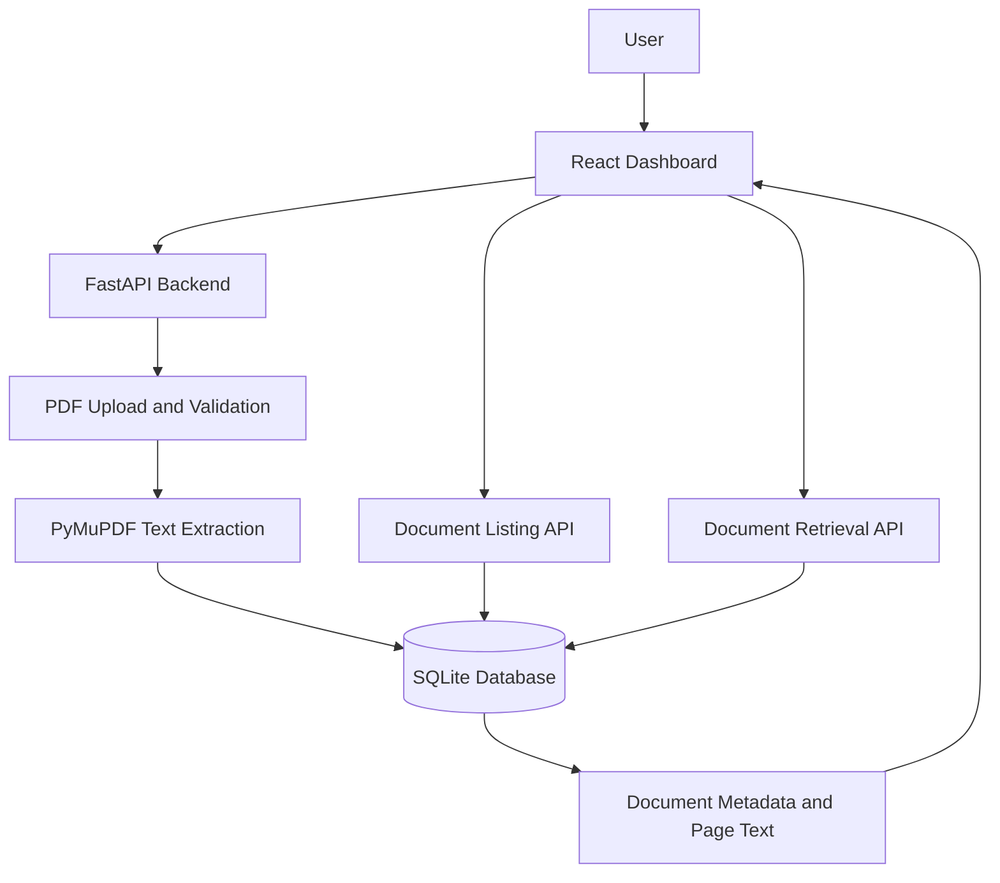
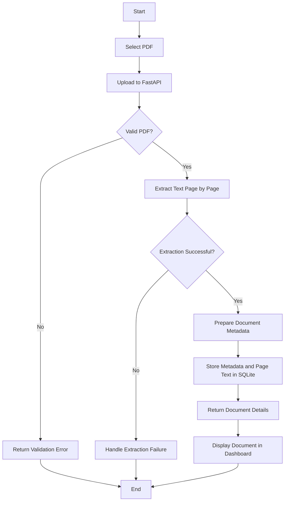
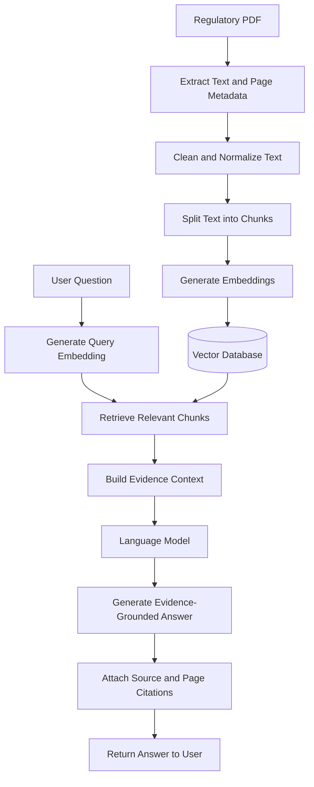
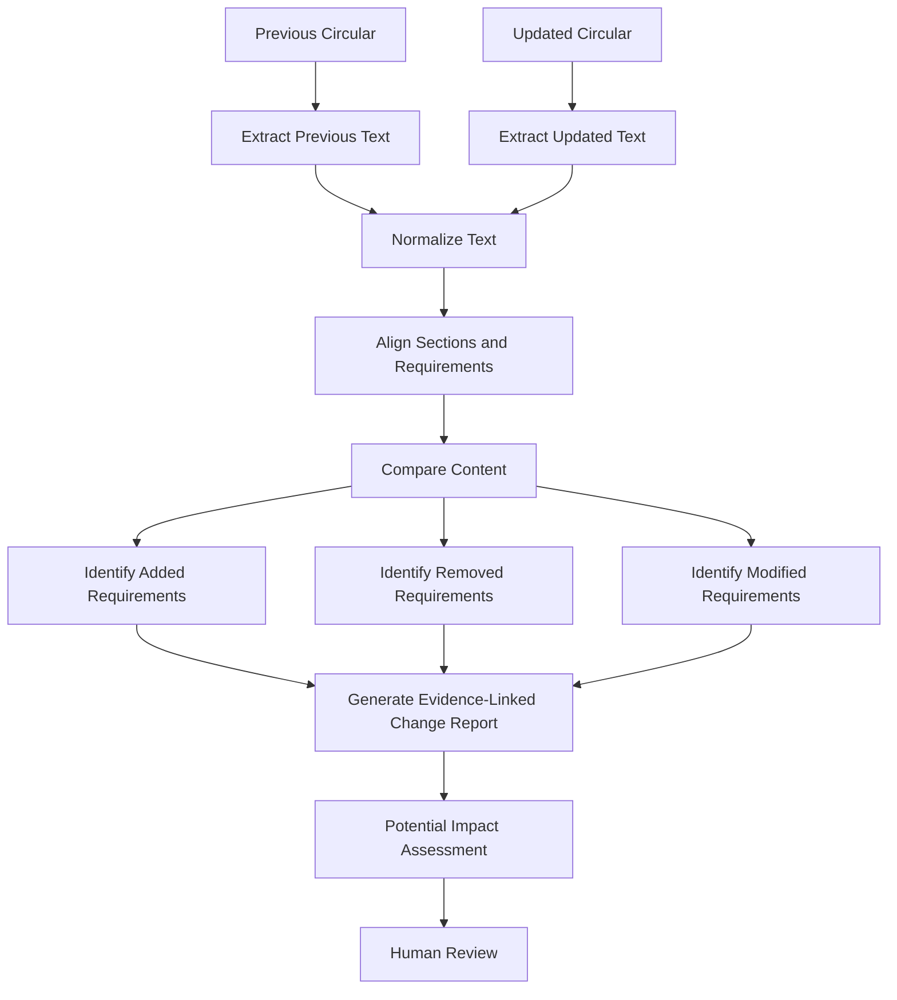

# RegulaLens AI

### AI-Powered Regulatory Intelligence Platform

**Making regulatory documents easier to process, understand, and analyze.**

RegulaLens AI is an AI-powered regulatory intelligence platform designed to simplify how users interact with regulatory documents issued by institutions such as the Reserve Bank of India (RBI) and the Securities and Exchange Board of India (SEBI).

The project aims to build a document-processing and retrieval system that can eventually support semantic search, citation-backed question answering, regulatory document comparison, and impact analysis.

The current implementation establishes the foundation through PDF text extraction, document storage, document retrieval APIs, and a React dashboard.

---

## Table of Contents

* [Problem Statement](#problem-statement)
* [Project Vision](#project-vision)
* [Key Features](#key-features)
* [Technology Stack](#technology-stack)
* [System Architecture](#system-architecture)
* [Document Processing Workflow](#document-processing-workflow)
* [Planned AI and RAG Workflow](#planned-ai-and-rag-workflow)
* [Project Structure](#project-structure)
* [Getting Started](#getting-started)
* [API Reference](#api-reference)
* [Database Design](#database-design)
* [Development Roadmap](#development-roadmap)
* [Design Principles](#design-principles)
* [Current Project Status](#current-project-status)
* [Future Scope](#future-scope)
* [Contributing](#contributing)
* [Author](#author)

---

## Problem Statement

Regulatory institutions publish circulars, notifications, guidelines, and compliance requirements that organizations must review and interpret.

Working with these documents can present several challenges:

* Lengthy PDFs make manual review time-consuming.
* Finding specific requirements across multiple documents can be difficult.
* Comparing updated circulars with previous versions requires careful examination.
* Understanding the potential impact of a regulatory change can involve substantial manual effort.
* AI-generated interpretations need to be traceable to reliable source material.

RegulaLens AI aims to address these challenges by building a structured document-processing pipeline and extending it with retrieval-based AI capabilities.

## Project Vision

The long-term goal is to develop a regulatory intelligence platform that helps users:

1. Upload and process regulatory documents.
2. Retrieve relevant information from stored documents.
3. Ask questions about regulatory requirements in natural language.
4. Receive answers grounded in source passages with page-level citations.
5. Compare document versions and identify changes.
6. Explore potential compliance implications for further review.

The platform is intended to support regulatory research and compliance workflows, not replace professional legal or compliance judgment.

## Key Features

### Currently Implemented

* **PDF Upload:** Accept PDF documents through the backend API.
* **Text Extraction:** Extract text page by page using PyMuPDF.
* **Document Storage:** Store document metadata and extracted page content in SQLite.
* **Document Listing:** Retrieve previously stored documents.
* **Document Retrieval:** Fetch an individual document and its extracted page text.
* **REST API:** Expose backend functionality through FastAPI.
* **Dashboard Foundation:** Provide a React-based interface for document-management functionality.

### Planned Features

* **Semantic Search:** Find relevant passages using vector embeddings.
* **AI-Powered Question Answering:** Ask questions about regulatory documents.
* **Source Citations:** Connect answers to supporting documents and page references.
* **Document Version Comparison:** Identify additions, removals, and modifications.
* **Regulatory Change Monitoring:** Track differences between document versions.
* **Impact Analysis:** Highlight potentially affected compliance areas for human review.

Planned features are part of the development roadmap and are not represented as completed functionality.

---

## Technology Stack

| Component             | Technology                                   |
| --------------------- | -------------------------------------------- |
| Frontend              | React                                        |
| Frontend Build Tool   | Vite                                         |
| UI Icons              | Lucide React                                 |
| Backend Framework     | FastAPI                                      |
| Programming Language  | Python                                       |
| API Server            | Uvicorn                                      |
| PDF Processing        | PyMuPDF                                      |
| Database              | SQLite                                       |
| Planned Vector Search | ChromaDB or another suitable vector database |
| Planned AI Retrieval  | Retrieval-Augmented Generation (RAG)         |
| Version Control       | Git and GitHub                               |

The final AI and vector database components will be selected and integrated as development progresses.

---

## System Architecture

The following diagram represents the current high-level document-processing architecture.



### Architecture Overview

* **React Dashboard:** Provides the user interface for document operations.
* **FastAPI Backend:** Handles HTTP requests, upload processing, and document retrieval.
* **PDF Processing Layer:** Validates uploaded PDFs and extracts text from individual pages.
* **SQLite Database:** Stores document metadata and extracted page text.
* **Retrieval APIs:** Allow the frontend to list and open stored documents.

---

## Document Processing Workflow

The current document-ingestion process follows this workflow.



This workflow describes the intended request lifecycle. Exact error handling and frontend feedback may evolve as testing and validation improve.

---

## Planned AI and RAG Workflow

Retrieval-Augmented Generation (RAG) is a planned extension of the existing document-processing pipeline.

Instead of asking an AI model to answer solely from its internal knowledge, the system will retrieve relevant passages from processed documents and use them as evidence for its response.



### Planned RAG Components

1. **Text Chunking:** Divide extracted text into manageable passages while preserving document identifiers and page metadata.
2. **Embedding Generation:** Convert chunks into vector representations for semantic retrieval.
3. **Vector Storage:** Store embeddings and associated metadata in a vector database.
4. **Semantic Retrieval:** Retrieve passages relevant to a user's question.
5. **Answer Generation:** Use retrieved passages as context for an AI-generated response.
6. **Citation Handling:** Link answers to source documents and pages so users can verify the evidence.

This pipeline is planned and has not yet been implemented end to end.

---

## Planned Regulatory Change Analysis

A future version of RegulaLens AI will support comparing versions of regulatory documents.



The objective is to help users identify meaningful changes without treating every textual difference as a regulatory change. Future implementations will need suitable comparison logic, source references, and validation.

---

## Project Structure

The current repository is organized around a separate frontend and backend.

```text
regulalens-ai/
├── backend/
│   └── app/
│       ├── main.py
│       └── database.py
├── frontend/
│   ├── src/
│   │   ├── App.jsx
│   │   ├── App.css
│   │   ├── index.css
│   │   └── main.jsx
│   ├── package.json
│   └── package-lock.json
├── .gitignore
└── README.md
```

Additional files, such as dependency manifests, tests, and configuration files, may be present as the project evolves. Local environment folders and generated database files should not be committed unless intentionally required.

---

## Getting Started

### Prerequisites

Install the following tools:

* Python 3.10 or later
* Node.js and npm
* Git

### 1. Clone the Repository

```bash
git clone https://github.com/rajshreesinha-23/regulalens-ai.git
cd regulalens-ai
```

### 2. Set Up the Backend

Create a virtual environment from the project root.

**Windows PowerShell:**

```powershell
python -m venv .venv
.\.venv\Scripts\Activate.ps1
```

Install the required Python packages:

```powershell
python -m pip install fastapi uvicorn python-multipart pymupdf
```

Start the backend server:

```powershell
python -m uvicorn backend.app.main:app --reload
```

If you already have a virtual environment, activate it rather than creating another one.

The backend should be available at:

* Application root: http://127.0.0.1:8000/
* Interactive API documentation: http://127.0.0.1:8000/docs
* Health endpoint: http://127.0.0.1:8000/health

### 3. Set Up the Frontend

Open a second terminal from the repository root:

```powershell
cd frontend
npm install
npm install lucide-react recharts
```

Start the development server:

```powershell
npm run dev
```

Open the local URL printed by Vite, usually:

http://localhost:5173

Keep both servers running while using the application.

### 4. Connect the Frontend and Backend

The frontend must send API requests to the backend at:

```text
http://127.0.0.1:8000
```

The backend must also allow the frontend's local development origin through CORS configuration, including `http://localhost:5173` and, if used, `http://127.0.0.1:5173`.

If the dashboard loads but document requests fail, check the browser console, backend terminal, and CORS configuration.

---

## API Reference

The current backend exposes the following endpoints.

| Method | Endpoint                   | Description                                                |
| ------ | -------------------------- | ---------------------------------------------------------- |
| `GET`  | `/`                        | Returns the application welcome response                   |
| `GET`  | `/health`                  | Reports backend health                                     |
| `POST` | `/documents/extract`       | Uploads a PDF, extracts page text, and stores the document |
| `GET`  | `/documents`               | Lists stored documents                                     |
| `GET`  | `/documents/{document_id}` | Retrieves document details and extracted page content      |

### Upload a Document

**Endpoint:** `POST /documents/extract`

This endpoint accepts a PDF upload, validates the input, extracts text from its pages, and stores the resulting document information.

### List Documents

**Endpoint:** `GET /documents`

Returns the available stored documents and their metadata.

### Retrieve a Document

**Endpoint:** `GET /documents/{document_id}`

Returns the selected document's metadata and extracted page content.

For request schemas and response details, use the interactive API documentation at `/docs` while the backend is running.

---

## Database Design

The current SQLite database includes a `documents` table with the following fields:

| Field        | Purpose                               |
| ------------ | ------------------------------------- |
| `id`         | Unique document identifier            |
| `filename`   | Original uploaded filename            |
| `page_count` | Number of pages in the document       |
| `pages_json` | Extracted page text stored as JSON    |
| `created_at` | Timestamp when the record was created |

### Storage Approach

The current implementation stores the extracted page content together with document metadata. This is a simple starting point for the prototype.

As the project grows, the storage design can be extended to support separate page records, document versions, chunk metadata, embeddings, and processing status.

---

## Development Roadmap

### Phase 1 — Document Processing Foundation

* [x] Set up FastAPI backend.
* [x] Implement PDF upload and text extraction.
* [x] Store document metadata and extracted text in SQLite.
* [x] Add document listing and retrieval endpoints.
* [x] Build the initial React dashboard foundation.
* [ ] Complete end-to-end testing of PDF upload and document viewing.
* [ ] Add automated tests for ingestion and retrieval.

### Phase 2 — Retrieval-Augmented Generation

* [ ] Implement text cleaning and chunking.
* [ ] Preserve page and section metadata.
* [ ] Generate text embeddings.
* [ ] Integrate a vector database.
* [ ] Implement semantic retrieval.
* [ ] Add citation-backed question answering.

### Phase 3 — Regulatory Intelligence

* [ ] Support document version management.
* [ ] Compare circulars and document versions.
* [ ] Detect added, removed, and modified requirements.
* [ ] Generate evidence-grounded change summaries.
* [ ] Explore potential compliance impact analysis.
* [ ] Add review workflows for validating AI-generated results.

### Phase 4 — Quality and Production Readiness

* [ ] Improve input validation and error handling.
* [ ] Add frontend and backend automated tests.
* [ ] Improve upload progress and processing feedback.
* [ ] Add structured logging and observability.
* [ ] Review API security and document-access controls.
* [ ] Prepare deployment configuration and documentation.

---

## Design Principles

### Traceability

AI-generated answers should reference the source material that supports them.

### Reliability

Document ingestion and retrieval should be dependable before advanced AI capabilities are introduced.

### Transparency

The platform should distinguish extracted source facts from AI-generated interpretations.

### Modularity

Document processing, storage, retrieval, AI generation, and presentation should remain separate components.

### Human Oversight

Potential regulatory implications should be presented for review rather than treated as definitive legal or compliance decisions.

---

## Current Project Status

RegulaLens AI is under active development.

The current implementation establishes a working FastAPI application, PDF text extraction, SQLite persistence, document retrieval endpoints, and a React dashboard foundation.

The next development priorities are to verify the complete upload-to-view workflow, improve automated testing, implement text chunking with page metadata, and build the foundation for semantic search and retrieval-augmented generation.

**Note:** The RAG pipeline, semantic search, automated regulatory change detection, and AI-powered impact analysis described in this README are planned capabilities, not completed features.

## Future Scope

Potential future enhancements include:

* Support for additional regulatory document formats.
* Section-aware retrieval and search.
* More robust document-version tracking.
* Evidence-linked regulatory change reports.
* Better handling of scanned PDFs through OCR.
* User authentication and document access controls.
* Evaluation of retrieval quality, answer correctness, and citation accuracy.
* Deployment as a secure, scalable web application.

## Contributing

Contributions, suggestions, and feedback are welcome.

For a contribution:

1. Fork the repository.
2. Create a feature branch.
3. Make a focused change.
4. Test the change locally.
5. Open a pull request describing the implementation and testing performed.

For significant features, open an issue first to discuss the proposed approach.

## Author

**Rajshree Sinha**

* GitHub: [rajshreesinha-23](https://github.com/rajshreesinha-23)
* Project Repository: [RegulaLens AI](https://github.com/rajshreesinha-23/regulalens-ai)

---

*RegulaLens AI — Building toward more accessible, traceable, and intelligent regulatory analysis.*
