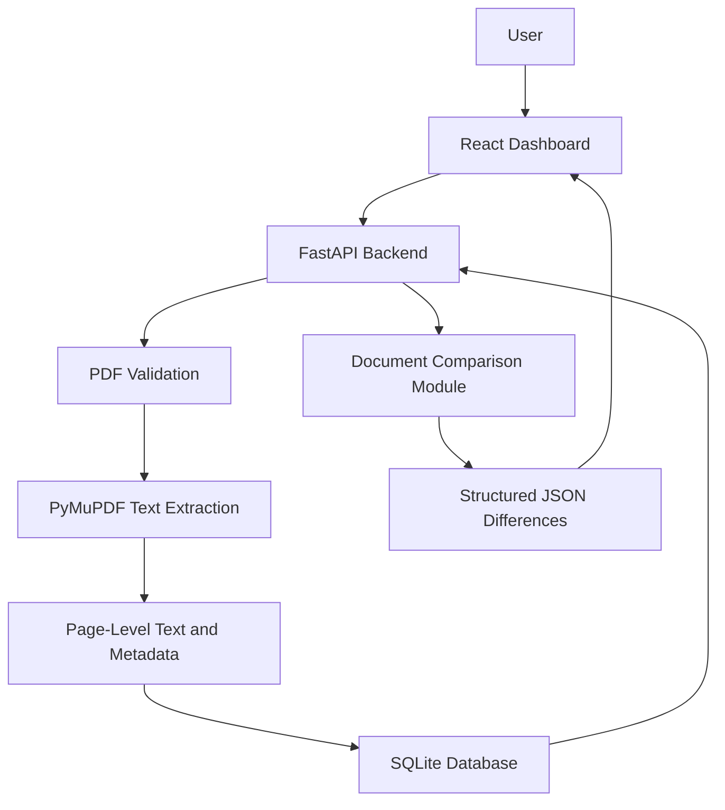
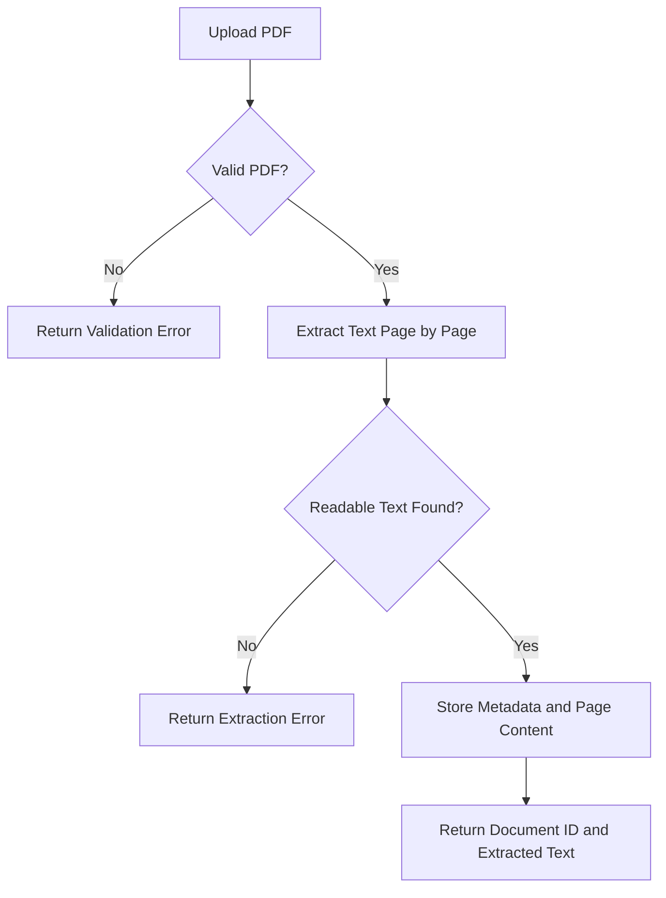
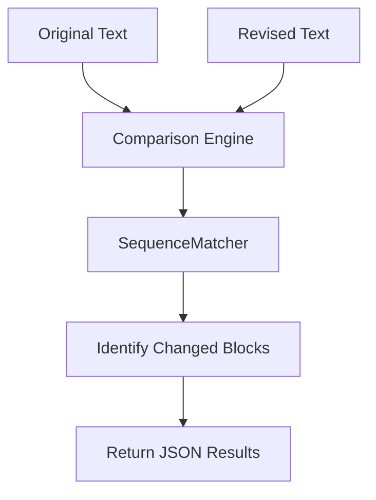

# RegulaLens AI

**AI-Powered Regulatory Intelligence and Document Analysis Platform**

RegulaLens AI is a regulatory intelligence platform designed to help users analyze regulatory documents, extract information from PDF circulars, and identify changes between document versions.

The project aims to simplify regulatory document management by combining document processing, text comparison, and, in future iterations, retrieval-augmented generation (RAG) for evidence-based regulatory question answering.

> **Project status:** Under active development. PDF text extraction, SQLite document storage, a React dashboard foundation, and a text-based document comparison API have been implemented. RAG-based question answering, automated regulatory impact analysis, and full document-to-document comparison are planned enhancements.

---

## Table of Contents

- [Problem Statement](#problem-statement)
- [Project Objectives](#project-objectives)
- [Current Features](#current-features)
- [Technology Stack](#technology-stack)
- [System Architecture](#system-architecture)
- [Application Workflow](#application-workflow)
- [Document Comparison](#document-comparison)
- [API Documentation](#api-documentation)
- [Project Structure](#project-structure)
- [Getting Started](#getting-started)
- [Testing](#testing)
- [Current Limitations](#current-limitations)
- [Roadmap](#roadmap)
- [Future Enhancements](#future-enhancements)
- [Contributing](#contributing)
- [Disclaimer](#disclaimer)

---

## Problem Statement

Financial and compliance teams often need to review lengthy regulatory documents, maintain document records, and identify changes between updated circulars.

Manually comparing versions can be time-consuming and may make it difficult to locate relevant changes quickly.

RegulaLens AI aims to address these challenges by providing a centralized platform for document ingestion, text extraction, version comparison, and eventually AI-assisted regulatory analysis.

## Project Objectives

- Extract readable text from uploaded regulatory PDF documents.
- Preserve page-level information for document traceability.
- Store document metadata and extracted content in a database.
- Provide API endpoints to upload, list, and retrieve documents.
- Identify textual differences between two document versions.
- Build a foundation for citation-backed regulatory question answering.
- Develop future capabilities for change tracking and impact analysis.

## Current Features

### 1. PDF Upload and Validation

- Accepts PDF documents through a FastAPI endpoint.
- Validates file extensions and file sizes.
- Handles empty, invalid, and password-protected PDF files.
- Reports when a PDF has no readable text, such as a scanned document that requires OCR.

### 2. PDF Text Extraction

- Uses PyMuPDF to extract text from PDF documents.
- Processes documents page by page.
- Preserves page numbers alongside extracted text.
- Returns the extracted content in the API response.

### 3. Database Storage

- Uses SQLite for document persistence.
- Stores document metadata, page count, and extracted page content.
- Provides endpoints to list stored documents and retrieve individual documents.

### 4. Text-Based Document Comparison

- Uses Python's built-in `difflib.SequenceMatcher`.
- Compares two supplied text versions.
- Detects inserted, deleted, and replaced text blocks.
- Returns structured JSON containing the type of change, previous text, and revised text.

**Current scope:** The comparison endpoint accepts text supplied directly in the API request. Automatically retrieving two uploaded documents from the database and comparing them is a planned enhancement.

### 5. React Frontend Foundation

- Provides a React-based dashboard foundation.
- Supports development of the document upload and viewing workflow.
- Is intended to serve as the interface for future comparison and AI-powered analysis features.

### 6. REST API

- Built using FastAPI.
- Provides interactive API documentation through Swagger UI.
- Supports testing endpoints independently of the frontend.

---

## Technology Stack

| Component | Technology |
|---|---|
| Frontend | React |
| Backend | Python, FastAPI |
| PDF processing | PyMuPDF |
| Database | SQLite |
| Document comparison | Python `difflib` |
| Data validation | Pydantic |
| API documentation | Swagger UI / OpenAPI |
| Version control | Git and GitHub |
| Future AI capabilities | RAG, embeddings, vector search, LLMs |

---

## System Architecture

The current application separates the frontend, API layer, document-processing logic, and database.



The diagram represents the current backend capabilities and the intended frontend workflow. Full integration of document comparison into the dashboard remains future work.

## Application Workflow

### PDF ingestion workflow



### Document comparison workflow



---

## Document Comparison

The comparison module is located at:

`backend/app/document_comparison.py`

It exposes the function:

`compare_documents(old_text, new_text)`

Example:

```python
from backend.app.document_comparison import compare_documents

old_text = "Reports must be submitted monthly."
new_text = "Reports must be submitted weekly."

result = compare_documents(old_text, new_text)

print(result)
```

Example output:

```json
{
  "total_changes": 1,
  "changes": [
    {
      "type": "replace",
      "old_text": "Reports must be submitted monthly.",
      "new_text": "Reports must be submitted weekly."
    }
  ]
}
```

The `total_changes` field represents the number of detected change blocks, not necessarily the number of individual regulatory requirements affected.

---

## API Documentation

Start the backend and open:

**Swagger UI:** http://127.0.0.1:8000/docs

### Available endpoints

| Method | Endpoint | Purpose |
|---|---|---|
| GET | `/` | Check the application welcome endpoint |
| GET | `/health` | Check backend health |
| POST | `/documents/extract` | Upload a PDF and extract its text |
| GET | `/documents` | List stored documents |
| GET | `/documents/{document_id}` | Retrieve a stored document |
| POST | `/documents/compare` | Compare two text versions |

### 1. Health Check

**Request**

```http
GET /health
```

Checks whether the backend is running.

### 2. Extract a PDF

**Request**

```http
POST /documents/extract
```

Upload a PDF using the `multipart/form-data` request in Swagger UI.

The current upload endpoint enforces a 10 MB file-size limit.

### 3. List Documents

**Request**

```http
GET /documents
```

Returns stored document metadata, including identifiers, filenames, page counts, and creation timestamps.

### 4. Retrieve a Document

**Request**

```http
GET /documents/{document_id}
```

Retrieves a stored document and its extracted page content.

### 5. Compare Two Text Versions

**Request**

```http
POST /documents/compare
```

Example request body:

```json
{
  "old_text": "Reports must be submitted monthly.",
  "new_text": "Reports must be submitted weekly."
}
```

The response contains a list of detected changes, including the previous and revised text.

---

## Project Structure

```text
regulalens-ai/
│
├── backend/
│   └── app/
│       ├── main.py
│       ├── database.py
│       ├── document_comparison.py
│       └── regulalens.db
│
├── frontend/
│   └── src/
│       ├── App.jsx
│       ├── App.css
│       ├── index.css
│       └── main.jsx
│
├── test_document_comparison.py
├── requirements.txt
├── README.md
└── .gitignore
```

The database file is created and used by the application. It should not be committed if it contains local or sensitive data; the repository should document how to initialize the database instead.

---

## Getting Started

### Prerequisites

Install the following before running the project:

- Python 3.10 or later
- Node.js and npm
- Git
- Visual Studio Code (recommended)

### 1. Clone the repository

```bash
git clone https://github.com/rajshreesinha-23/regulalens-ai.git
cd regulalens-ai
```

### 2. Set up the Python environment

On Windows PowerShell:

```powershell
python -m venv .venv
.\.venv\Scripts\Activate.ps1
```

If PowerShell blocks virtual-environment activation, you can run the Python executable directly using `.\.venv\Scripts\python.exe`.

### 3. Install backend dependencies

```powershell
python -m pip install -r requirements.txt
```

The backend dependencies include FastAPI, Uvicorn, PyMuPDF, and `python-multipart`.

### 4. Start the backend

From the repository root:

```powershell
python -m uvicorn backend.app.main:app --reload
```

The backend should be available at:

- Application: http://127.0.0.1:8000
- Interactive API documentation: http://127.0.0.1:8000/docs
- Health check: http://127.0.0.1:8000/health

### 5. Start the frontend

Open a second terminal:

```powershell
cd frontend
npm install
npm run dev
```

Open the local development URL printed by Vite, commonly:

http://localhost:5173

If the frontend cannot communicate with the backend, check the API base URL and ensure the backend's CORS configuration permits the frontend development origin.

---

## Testing

### Test the document comparison module

From the repository root, run:

```powershell
python test_document_comparison.py
```

The test script compares sample document versions and prints the detected changes.

### Test the API

1. Start the FastAPI backend.
2. Open http://127.0.0.1:8000/docs.
3. Test `GET /health`.
4. Test `POST /documents/compare` with sample text.
5. Test PDF extraction with a readable, text-based PDF.
6. Confirm that uploaded documents can be listed and retrieved.

PDF extraction and document comparison should be tested independently before relying on their integration in the frontend.

---

## Current Limitations

RegulaLens AI is an evolving project. The following limitations are important:

- Scanned PDFs are not processed using OCR yet.
- Document comparison currently operates on supplied text rather than automatically retrieving two stored document versions.
- Textual differences are not necessarily equivalent to changes in regulatory meaning.
- The comparison engine does not yet provide semantic analysis or regulatory impact assessments.
- Citation-backed RAG question answering has not yet been implemented.
- Automated RBI/SEBI circular monitoring is planned, not currently implemented.
- Frontend integration of the comparison API and AI analysis features remains ongoing.

---

## Roadmap

### Phase 1 — Document Ingestion and Storage

- [x] FastAPI application setup
- [x] PDF upload and validation
- [x] Page-by-page text extraction
- [x] SQLite document storage
- [x] Document listing and retrieval endpoints

### Phase 2 — Document Comparison

- [x] Standalone text comparison module
- [x] Detect inserted, deleted, and replaced text blocks
- [x] FastAPI endpoint for comparing supplied text
- [x] Basic comparison test script
- [ ] Compare two stored documents by database ID
- [ ] Improve change grouping and reporting
- [ ] Integrate comparison results into the React dashboard

### Phase 3 — Retrieval-Augmented Generation

- [ ] Text chunking with page-level metadata
- [ ] Generate embeddings for document chunks
- [ ] Add vector search using Chroma or a suitable alternative
- [ ] Answer questions using retrieved regulatory passages
- [ ] Provide source-document and page citations
- [ ] Evaluate answer relevance and grounding

### Phase 4 — Regulatory Intelligence

- [ ] Compare related circular versions automatically
- [ ] Explain the significance of detected changes
- [ ] Identify potentially affected compliance requirements
- [ ] Generate evidence-backed review suggestions
- [ ] Keep human review in the decision-making process

### Phase 5 — Monitoring and Deployment

- [ ] Integrate reliable sources of public regulatory documents
- [ ] Add document version tracking
- [ ] Build automated change-monitoring workflows
- [ ] Add authentication and access controls
- [ ] Add comprehensive automated tests
- [ ] Deploy the application

---

## Future Enhancements

Potential future improvements include:

- **Semantic comparison:** Identify changes in meaning rather than only matching text lines.
- **Citation-backed answers:** Link generated answers to the specific source pages and passages.
- **Regulatory impact analysis:** Highlight requirements that may need further compliance review.
- **Document version history:** Maintain a structured history of related documents.
- **OCR support:** Extract text from scanned PDFs.
- **Automated monitoring:** Track new or revised public regulatory documents.
- **Auditability:** Preserve evidence and document references for human review.

These capabilities will be developed and tested incrementally.

---

## Contributing

Contributions, suggestions, and bug reports are welcome.

To contribute:

1. Fork the repository.
2. Create a feature branch.
3. Make a focused change.
4. Run the relevant tests.
5. Submit a pull request describing the change.

Example:

```bash
git checkout -b feature/your-feature
git add .
git commit -m "Describe your change"
git push origin feature/your-feature
```

Please avoid committing virtual environments, secrets, local databases containing sensitive data, or generated files.

---

## Disclaimer

RegulaLens AI is a software development project intended to assist with regulatory document analysis.

It is not an official regulatory platform and does not replace legal, compliance, or professional judgment. Any future AI-generated analysis must be verified against the original regulatory documents and applicable requirements.

**Built as an ongoing project exploring document processing, backend engineering, regulatory intelligence, and AI-powered retrieval.**
