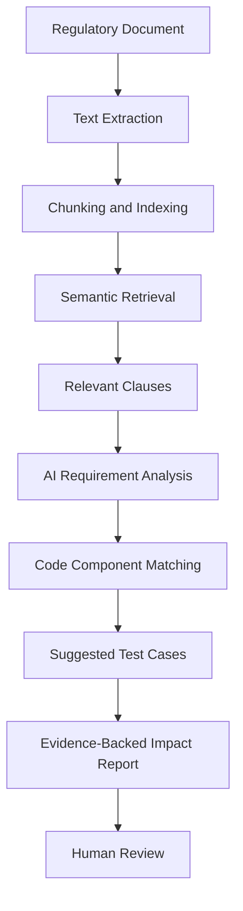
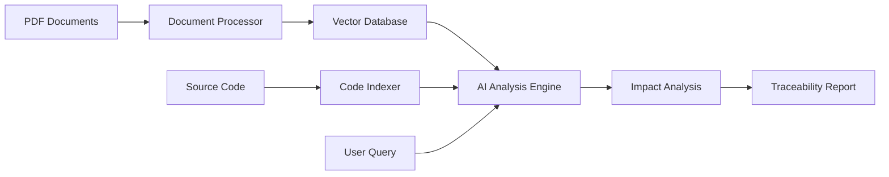
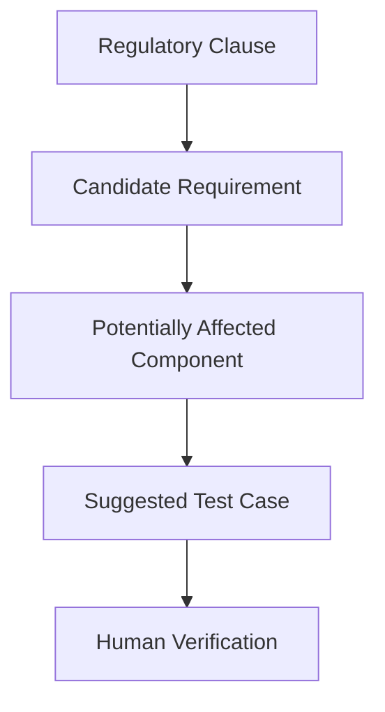

# RegulaLens AI

### From Regulatory Changes to Actionable Software Impact

**RegulaLens AI** is an AI-powered regulatory intelligence platform designed to help fintech teams understand how regulatory changes may affect their software systems.

It connects regulatory documents with software requirements, potentially affected code components, and suggested test cases — creating an evidence-backed path from a regulatory clause to its possible technical impact.

> **Regulation → Requirements → Code Impact → Test Recommendations**

---

## The Problem

Financial regulations are often published as lengthy documents containing complex legal and technical language. Translating these documents into software changes can require significant manual effort.

* 🔍 **Difficult to interpret:** Relevant clauses can be buried in lengthy regulatory documents.
* 🔗 **Limited traceability:** Teams may struggle to connect regulatory requirements with existing software components.
* 🧪 **Testing gaps:** Regulatory changes can introduce requirements that existing tests do not cover.
* ⏳ **Time-consuming reviews:** Engineers and compliance teams must manually compare regulatory changes with system behaviour.

## The Solution

RegulaLens AI uses document processing, retrieval-augmented generation (RAG), and code-aware analysis to help teams identify potential software impacts of regulatory requirements.

Instead of simply summarising a document, it aims to answer four practical questions:

| Question                                     | RegulaLens AI response                  |
| -------------------------------------------- | --------------------------------------- |
| What does the regulation say?                | Relevant clauses with source references |
| What might need to change?                   | Candidate software requirements         |
| Which parts of the system could be affected? | Potentially relevant code components    |
| How could the change be tested?              | Suggested test cases for human review   |

## How It Works

## Core Features

### 01 · Regulatory Document Intelligence

Extract and process text from regulatory PDFs, making relevant clauses easier to search and analyse.

### 02 · Evidence-Backed AI Analysis

Use retrieval-augmented generation to ground AI-generated explanations in relevant regulatory passages rather than relying only on general model knowledge.

### 03 · Requirement Extraction

Convert selected regulatory clauses into structured, candidate software requirements that can be reviewed by engineers and compliance teams.

### 04 · Code Impact Mapping

Compare extracted requirements with available code components to identify potentially affected files, modules, or functions.

### 05 · Test Case Recommendations

Generate candidate test scenarios from identified requirements to help teams investigate functional gaps and plan regression testing.

### 06 · Traceability Reports

Connect each regulatory clause to its proposed requirement, potential code impact, and recommended tests — while preserving references to the original evidence.

## System Architecture

## The AI Behind RegulaLens

| Concept                          | Purpose                                                                       |
| -------------------------------- | ----------------------------------------------------------------------------- |
| **Large Language Models (LLMs)** | Interpret regulatory clauses and generate structured analysis                 |
| **RAG**                          | Retrieve relevant source passages to ground responses                         |
| **Embeddings**                   | Represent document passages for semantic search                               |
| **Vector Search**                | Find conceptually relevant clauses and supporting evidence                    |
| **Code Analysis**                | Identify candidate relationships between requirements and software components |
| **Prompt Engineering**           | Guide structured, consistent, reviewable outputs                              |

## Regulatory Traceability

The central idea is to maintain a connection between the original source and every proposed technical action.

Each stage should preserve its supporting evidence and distinguish source-backed facts from AI-generated suggestions.

## Technology Stack

| Layer                        | Planned Technology                    |
| ---------------------------- | ------------------------------------- |
| Backend API                  | Python, FastAPI                       |
| PDF Processing               | PyMuPDF                               |
| AI and RAG                   | LLMs, embeddings, retrieval pipelines |
| Vector Storage               | ChromaDB or FAISS                     |
| Code and Requirement Storage | SQLite or PostgreSQL                  |
| Frontend                     | React, Vite                           |
| Testing                      | pytest                                |

## Intended Impact

RegulaLens AI aims to help fintech engineering and compliance teams:

* Reduce the manual effort involved in analysing regulatory documents.
* Improve traceability between regulatory clauses and technical requirements.
* Identify software components that may need further investigation.
* Discover potential testing gaps earlier in the change process.
* Produce clearer, evidence-backed reports for human review.

## Responsible AI

RegulaLens AI is intended to support—not replace—compliance professionals, software engineers, or legal experts.

Its outputs are recommendations, not definitive compliance determinations. Code-impact matches and test cases require verification, and regulatory conclusions must remain grounded in the original source material.

---

**RegulaLens AI — Making regulatory change easier to trace, investigate, and test.**
